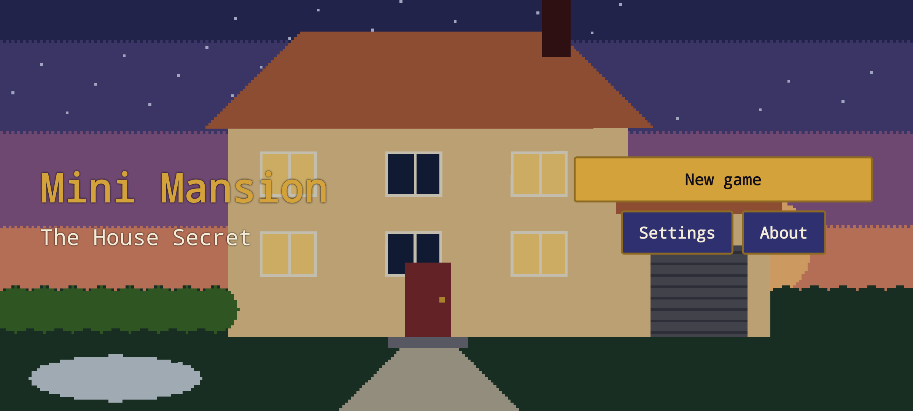
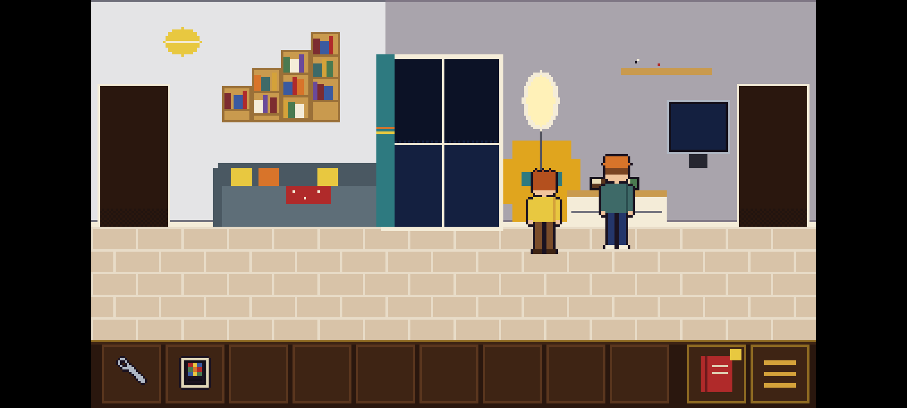
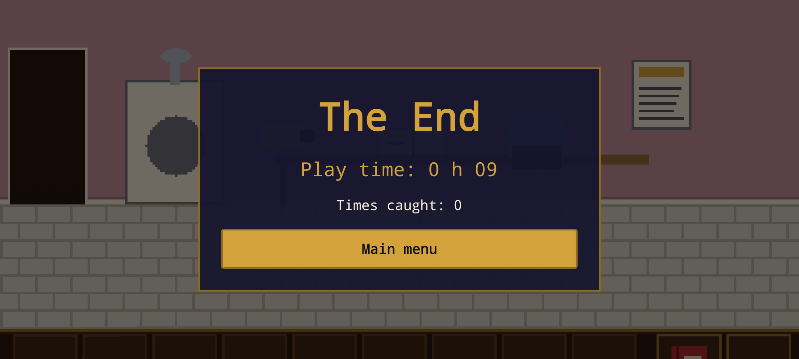

# Mini Mansion

A small Android game made with React Native. The game speaks French and English (it follows the phone's language;
you can change it in the settings).

## Screenshots

<!-- factory:screenshots:start -->
<p>
  
  
  
</p>
<!-- factory:screenshots:end -->

## Play

Download the APK attached to the latest release (if any) or build it yourself (below), then install it on an
Android phone (allow installation from unknown sources).

## Privacy

- No account, no ads, no personal data.
- Anonymous usage statistics and crash reports (Firebase) are sent **only if you accept** on first launch.
  You can change your choice at any time in *Settings*.
- What is sent then: play progress (puzzle number, play time in seconds), captures (room, count), settings and
  language changes, crash reports. No identifier, no advertising ID.

## Credits

Inspired by Maniac Mansion; not affiliated with or endorsed by Lucasfilm or LucasArts. All art, sound and text are
original: images are drawn in code and sounds are synthesised (see [assets/LICENSES.md](assets/LICENSES.md)).

## Build from source

Requirements: Node.js 20+, JDK 17, Android SDK.

```bash
npm install
npm test
```

Firebase configuration is not part of this repository. To build with telemetry, create your own Firebase project
and place its `google-services.json` in `firebase/` (see [firebase/README.md](firebase/README.md)). Without it,
the game builds and runs with telemetry disabled.

Release signing reads `FACTORY_STORE_FILE`, `FACTORY_STORE_PASSWORD`, `FACTORY_KEY_ALIAS` and
`FACTORY_KEY_PASSWORD` from your user-level `~/.gradle/gradle.properties`; without them the release build is
signed with the debug key.

## Project docs

- [Product requirements](docs/PRD.md)
- [Architecture decisions](docs/adr/)
- [Verification evidence](docs/evidence/)
