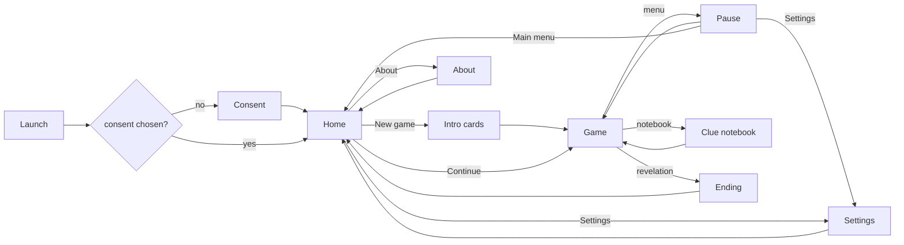

# PRD: Mini Mansion

Status: approved
Project slug: mini-mansion
Final app name: Mini Mansion
Android package: io.github.nhilaire.minimansion
Version target: 0.2.0
Last updated: 2026-10-23

> Written in English. Player-facing text is quoted in the "Player copy" section, in every language of the game
> (`factory-app.json` "languages"; French is the reference).
> Status becomes `approved` only after the user explicitly approves this document.
>
> Sources: `docs/BRIEF.md` (discovery answers), which amends the user's local draft "Le Secret de la Maison" and its
> navigation plan, and the user's phone tests (2026-10-21: 21 notes in `docs/evidence/v0.1.0/RELEASE.md`; 2026-10-22:
> unskippable capture and front door scenes, Papa answers the doorbell after 30 s; 2026-10-23, after v0.1.0 was
> accepted: a longer story with the recipe in three fragments, a delivered parcel, the neighbours' cat, a garden hose,
> Florent's bike and a power cut, and the rule that an inhabitant lured out twice needs a second
> reason that only becomes possible later), which amend this PRD: timed doorbell sequence, kitchen/garden/front captures, side gates, merged music corner and dining
> room, breaker, cellar hatch, lab door code, optional kitchen recipe, art from the author's room photos. Every rule
> kept is restated here: this PRD is the only source of truth.

## Summary

Mini Mansion is a family pixel-art point-and-click adventure inspired by Maniac Mansion, set in a family house drawn
from the author's room photos. A rumour runs through the school: in a house of the neighbourhood, someone has
invented a secret recipe with extraordinary powers that could cause a disaster in town. Sam, a pupil who heard it in
the playground, decides to investigate. Sam slips into the house through the key under the doormat, studies the
habits of the five inhabitants, lures them away with clever distractions (a ball, drums, a chess piece, the
doorbell, the washing machine, a new dough, a runaway garden hose, a repaired bike, a power cut), combines objects,
cracks a chess problem, a computer and a safe. Act II: the father has cut his recipe in three (one piece in the
safe, one hidden in the wine cellar, one in an old trunk of the attic) and its secret ingredient is delivered today.
Sam reads invisible ink, wins the parcel back from the neighbours' cat, puts the cellar bottles in order, opens the
trunk and the father's lab behind a painted-over door in the attic. The truth: a gluten-free, lactose-free chocolate
cake for the town baking contest, whose secret touch, the delivered tonka bean, Sam grates into the dough before the
whole family gathers in the lab, one after the other. The fun
is in observing, sneaking, a few tense timed escapes and the "aha" of each puzzle, with family humour; being caught
only sends Sam to the wine cellar, never loses progress, and there is no hint system.

Pitch in French: « Une rumeur court à l'école : dans cette maison, quelqu'un aurait inventé une recette capable de
provoquer une catastrophe. Glisse-toi à l'intérieur, déjoue la famille et perce le secret ! »

## Target players

- Families, from about 10 years old; light humour and light mystery, never scary, no violence.
- Played on the couch or in transport, both hands, landscape.
- Total game length 3 h or more without help, over sessions of 10-30 min thanks to the autosave.
- Accessibility: finger-sized hotspots (>= 44 dp), readable pixel font scaled for phones, text stays on screen until
  tapped or its reading delay has elapsed. No reflex challenge; the only timed moments are the doorbell sequence, the
  dough, Maman changing after the hose, Papa at the fuse box and the delivery (30 s to 2 min, counted only while
  playing), and a missed window only means a capture.

## Core loop

1. Explore a place: tap the floor to walk, tap hotspots to see the possible actions, listen at closed doors.
2. Gather clues: look at things, listen at doors, read the clue notebook.
3. Take items, combine them, use them on hotspots or characters; try the small gags of each room.
4. Lure an inhabitant away (a distraction, sometimes a timed window) to enter a guarded place safely.
5. A puzzle is solved: a new item, place, clue or character move opens; "what does this unlock?" pulls the player on.

## Use cases

| ID | As a player I want to... | So that... |
|---|---|---|
| UC-01 | choose whether to share anonymous statistics at first launch, in my phone's language | my privacy is respected |
| UC-02 | start a new game with a short intro and a guided first scene | I understand the story and the controls |
| UC-03 | walk Sam around places and between places | I can explore the house and its garden |
| UC-04 | look at, take, use and combine objects, and listen at the doors of occupied rooms | I can investigate and solve puzzles |
| UC-05 | learn where each inhabitant is and lure them away, sometimes against the clock | I can sneak into guarded places |
| UC-06 | be caught without losing anything and get out of the wine cellar | a mistake is funny, not punishing |
| UC-07 | read my clue notebook | I remember codes and facts I learnt |
| UC-08 | quit at any moment and continue later where I was | a long adventure fits short sessions |
| UC-09 | reach the revelation and see my play time | I get closure and a sense of achievement |
| UC-10 | turn sound, music and statistics on or off, change the language, or erase my game | I control the experience |
| UC-11 | read why this game exists | I know the story behind it |

## Screens

- **Consent** (first launch only): factory consent screen in the current language, accept and refuse equally
  visible.
- **Home:** title "Mini Mansion" in pixel style with the subtitle `home.subtitle` over a pixel view of the house at
  dusk; buttons `home.continue` (only when an unfinished save exists), `home.newGame`, `home.settings`,
  `home.about`. `home.newGame` with an unfinished save asks `home.confirmNew` first.
- **Intro:** 5 text cards (`intro.cards`: the rumour, the disaster, Sam's investigation, the goal, the rule) over pixel illustrations, tap to advance, `intro.skip` button. The game then
  starts in `front` (in front of the house) with the first tutorial bubble.
- **Game:** the place scene (fills the screen height, landscape), Sam and the characters present, a text banner for
  spoken lines (also lines heard from another place, e.g. Papa at the front door), the inventory bar along the
  bottom (one row, pages), a notebook button and a menu button. Overlays: action menu, digit
  keypad (computer, safe, lab door), sequence pad (the cellar bottles, the trunk colour padlock), chess board,
  documents, capture fade, and the outside views (front door, kitchen, delivery, garden, Florent's ride, power cut,
  played without control.
- **Clue notebook:** the list of entries learnt so far (see "Clue notebook"), newest first, `notebook.empty` when
  none; `notebook.close`. The notebook button shows a dot while an entry is unread.
- **Pause:** `pause.resume`, `pause.settings`, `pause.home` (progress is already saved; timers are frozen).
- **Ending:** after CUT11, final cutscene cards, then `ending.title`, play time (`ending.time`), number of captures
  (`ending.captures`), `ending.home`. After the ending the save is marked finished: Home shows no `home.continue`.
- **Settings:** toggles `settings.sfx`, `settings.music`, `settings.telemetry`; language (`settings.languageAuto`
  + one entry per language, each named in itself); button `settings.erase` (with `settings.confirmErase`);
  `settings.back`.
- **About:** `about.storyTitle` + `about.story`, `about.authorTitle` + the word from the author (passionate
  independent developer, adapted to tu), `about.dataTitle` + data text, version.

## Rules and scoring

There is no score and no failure. Progress = flags, character states, timers, notebook and inventory of the pure
TypeScript engine. The "Ending" shows play time and captures.

### World and rendering

- Logical resolution 320x180 px per scene, scaled with nearest-neighbour to the screen height (letterboxed if
  needed). Scenes do not scroll.
- All art is pixel art drawn in code (pixel arrays and palettes in the repository). The places the author
  photographed (living room, music corner and dining room, kitchen, office, utility room, the four bedrooms, the
  parents' shower, the corridor bathroom, the pool) are redrawn by hand in code after the photos: same layout of the
  main furniture, same colours and characteristic objects, simplified to pixel art. The photos never enter the
  repository (`photos/` is git-ignored); no photo pixel is copied. The other places stay drawn from imagination.
- The stairs up (hall) and the stairs down to the garage are drawn seen from the front, in a doorway. The attic is
  cluttered (boxes, chairs, a trunk, an old lamp, a dressmaker's dummy...). Florent drums and Théo plays chess seen from the back. Julien's
  ball lies on the grass next to him. Théo's chess set is electronic (a board with a small screen).
- Each place has a walkable area (polygons). A tap on the floor makes Sam walk along the shortest path inside the
  walkable area to the tapped point, or to the nearest walkable point if the tap is outside. Speed 60 logical px/s.
- Sam: sprite 24x48 logical px, 4-frame walk cycle at 8 fps, 3 drawn directions (side mirrored for left/right, up,
  down), idle frame per direction. The 5 inhabitants have a 2-frame idle animation and a talk frame, plus an
  activity pose (drumming seen from the back, playing chess, folding laundry, cooking, gardening, playing football,
  typing, Papa at the fuse box). Act II adds the neighbours' cat (lying, eating), the parcel, the delivery van and
  driver, Maman soaked, Florent on his bike, Maman's gardening basket, and a dark flicker for
  the power cut.
- Touch targets: the scene is scaled so that 1 logical px >= 2 dp on a 360 dp-high landscape screen; every hotspot
  and exit tap area is at least 22x22 logical px (>= 44 dp).

### Characters

| Id | Name | Role | Start state |
|---|---|---|---|
| hero | Sam | the player, a pupil who heard the rumour at school | outside, in `front` |
| dad | Papa | invents the cake in secret; types at the computer | `office` |
| mom | Maman | folds laundry, then gardens | `parents` |
| julien | Julien | football fan, medals and trophies | `julien` (his room) |
| florent | Florent | drums, Nerf guns, video games, his bike in the garage | `florent` (his room) |
| theo | Théo | electronic chess and Rubik's Cubes | `theo` (his room) |

Non-player characters, seen only in the listed scenes: the neighbours' cat (garden, from CUT13 until E23), the
delivery driver (CUT13). Neither catches Sam.

The first names are fictional. Character states change only through the events and timers of the "Character
states" table; no random movement.

### Places and exits (canonical plan)

23 places (the music corner and the dining room are one place). An exit is a door or edge hotspot: tapping it walks
Sam there and changes place. An exit not listed here does not exist. In the user's plan, "Entrée" seen from outside
means the front of the house (`front`).

| Id | Place | Exits (direction -> destination) |
|---|---|---|
| front | Devant la porte (front door, doormat, doorbell, two side gates) | front door -> hall (locked until E01); left gate -> football and right gate -> pool (both locked until E18) |
| football | Coin foot | right gate -> front (locked until E18); middle -> pool; left -> garden |
| pool | Piscine (pool, cover, cover switch, pump, garden tap with the hose running to the garden) | left gate -> front (locked until E18); middle -> football; bay window -> living (locked from inside until opened from living) |
| garden | Jardin (flowers, swing, garden shed; the parcel and the cat after CUT13; Maman's gardening basket while she changes) | right -> football |
| hall | Entrée (stairs up in a doorway, coat rack, shoes) | front door -> front; left -> living; right -> corridor0; stairs -> landing |
| living | Salon (electronic chess set, sofa, bookshelf, TV) | right -> hall; left -> music; bay window -> pool |
| music | Coin musique et salle à manger (dining part on the left, next to the kitchen: sideboard, dining table, bread basket; music part on the right: piano, guitar, drums, xylophone) | right -> living; left -> kitchen |
| kitchen | Cuisine (food processor and Papa's bowl of hard dough on the worktop, a fridge to open before taking anything, oven; dead end) | right -> music |
| corridor0 | Couloir du rez-de-chaussée | back -> hall; door 1 -> wc0; door 2 -> office; door 3 -> utility; stairs down (in a doorway) -> garage |
| wc0 | WC du rez-de-chaussée (Japanese toilet) | door -> corridor0 |
| office | Bureau de Papa (computer, shelves with Papa's toolbox, locked desk drawer) | door -> corridor0 |
| utility | Cellier (washing machine, shelves, flours, a tin of sardines) | door -> corridor0 |
| garage | Garage (tools, Florent's bike with a flat tyre, crate, circuit breaker, ladder, hatch) | stairs up -> corridor0; ladder -> attic; hatch -> cellar (always open from the garage) |
| cellar | Cave à vin (wine racks, the bottle rack with Papa's four old bottles, the hatch from below) | hatch -> garage (stuck from below until E15) |
| attic | Grenier (lots of junk, paint stain, an old trunk with a colour padlock) | ladder -> garage; secret door -> laundry (after E12) |
| laundry | Buanderie secrète (Papa's lab, his recipe notebook with three torn pages) | door -> attic |
| landing | Couloir de l'étage (doors in this order from the stairs) | stairs -> hall; door 1 -> wc1; door 2 -> julien; door 3 -> bathroom; door 4 -> theo; door 5 -> florent; door 6 -> parents |
| wc1 | WC de l'étage | door -> landing |
| julien | Chambre de Julien (trophies, medals) | door -> landing |
| bathroom | Salle de bains du couloir (hair dryer) | door -> landing |
| theo | Chambre de Théo (Rubik's Cubes, chess posters) | door -> landing |
| florent | Chambre de Florent (Nerf, video games, Nerf modding kit, an overloaded power strip) | door -> landing |
| parents | Chambre des parents (bed, painting hiding the safe, sinks, mirror, shower) | door -> landing |

- The secret laundry adjoins the parents' bedroom but has no door to it: the attic is its only access.
- The bay window: from `pool`, using it says `line.bayLocked`; using it from `living` opens it for good (flag
  `bay_open`), after which it works both ways.
- The side gates: closed by one padlock (`line.gateLocked` when used without the key); the Clé du portail (hidden in
  a trainer in the hall shoes) used on any gate opens both for good (E18). Because the bay window also leads to the
  pool and the football corner from inside, E18 is optional: it only stops Sam from walking around the garden
  before entering the house.
- The cellar hatch: open when going down from the garage; from below it is stuck (`line.hatchStuck`) until the Barre
  de fer (in a wine rack) is used on it (E15), after which it works both ways for good.
- Richer rooms: every place except the corridors (corridor0, landing) has at least 5 hotspots, of which at least 2
  do more than a look line (a takeable item, a usable object or a gag); the corridors have at least 3; the attic has
  at least 8. Optional gags (no story effect): the Japanese toilet (wc0: the button
  sprays water and wets the floor for good, `wc_wet`), the piano (a wrong note), the TV (a baking show), the landing
  lamp (flickers), the rubber duck (squeaks).

### Interaction

- Tapping a hotspot opens the action menu next to it with only the verbs that apply: `verb.look` (always),
  `verb.take` (takeable items), `verb.listen` (closed doors of occupied rooms only: Sam puts an ear to the door and
  overhears the occupant talking to themself), `verb.use` (operable objects). Inhabitants can only be looked at. Tapping elsewhere closes it.
- Choosing a verb makes Sam walk to the hotspot's interaction point, face it, then the engine runs the action and
  shows the response line.
- When an inhabitant arrives where Sam stands (Florent at the drums in CUT05, Théo at the chessboard in CUT06), Sam
  steps aside as they arrive, so that nobody hides the other.
- Inventory: tapping an item selects it (highlight + banner `game.useWith`); the next tap on a hotspot, a character
  or another inventory item makes Sam apply it (walk there first for scene targets; "give" when the target is a
  character; "combine" when it is an item). Tapping the selected item again clears the selection. Long press on an
  item = look at it.
- Wrong combinations answer one of 6 generic lines in rotation (`wrong.0-5`), never consume anything and change
  no state.
- Spoken lines: shown in the banner in the speaker's colour; dismissed by a tap or after max(2 s, 50 ms x length).
  Input on the scene is ignored while a line, a cutscene or the front door view is playing.
- An item is removed from the inventory only when it is used up by its puzzle and is no longer needed.
- An item that is itself the hotspot (the hair dryer on its hook, the sardines, the flours, the pole) disappears from the
  scene once taken; furniture (shelves, bench, basket...) stays and says it is empty.
- When more items are held than the band shows, its last slot is a page button: a framed arrow with one dot per page.

### No conversation

- Sam never talks with the inhabitants: there is no dialogue menu and no conversation line. A character tapped in a
  scene offers only `verb.look`. Inhabitants catch Sam in their guarded places (see Guarded places).
- Listening at the closed door of an occupied room plays the occupant's door line, a monologue overheard through
  the door (see Clues). While Papa answers the doorbell, his office door gives `dad.doorComing`.

### Timers

- Timers count play time only (Game screen active, not paused, not in background), stored in the save as deadlines
  on the play-time clock.
- Durations: doorbell answer 30 s, Papa outside 60 s, Papa coming back 30 s, dough 120 s then Papa cooking 90 s,
  delivery 60 s after Papa becomes wary, Maman changing 90 s, Papa at the fuse box 60 s.
- Timers advance only while the scene is idle: not during a spoken line, a cutscene, an outside view or a capture
  scene. When several deadlines are due, they fire one after another in deadline order, each scene playing in full
  before the next one.
- The power cut trips the main fuse of the garage electrical panel (the same panel as the "Cellier" breaker of E17);
  it changes no other object state (washing machine, pool pump, computer, shower keep theirs).
- The testing fast mode makes timers run 30 times faster (it changes no rule and no save format).

### Character states

| Character | State | Place | Leaves it when | Next state |
|---|---|---|---|---|
| dad | at_desk | office | E16: Sam rings the doorbell (after E01, Papa not wary) | answering |
| dad | answering | office (still at his desk) | 30 s later: the front door view plays | outside |
| dad | outside | front | 60 s later: `line.dadGoingBack` is heard | returning |
| dad | returning | none (on his way back) | 30 s later | at_desk |
| dad | at_desk, answering, outside or returning | - | E19: 120 s after the dough is mixed (Papa not wary), Papa comes to the kitchen (CUT12) | cooking (kitchen) |
| dad | cooking | kitchen | 90 s later: `line.dadOven` (the dough is in the oven) | at_desk |
| dad | at_desk (wary) | office | E27: the power cut | fuses (garage) |
| dad | fuses | garage | 60 s later: `line.dadFusesDone` | at_desk |
| mom | folding | parents | E17: the washing machine's cycle ends (at the first place change after starting it) | gardening (garden) |
| mom | gardening | garden | E22: the garden hose soaks her (CUT14) | changing (parents) |
| mom | changing | parents | 90 s later: `line.momBack` | gardening |
| julien | in_room | julien | E02: the ball rolls to the football corner | football (football) until CUT11 |
| florent | in_room | florent | E03: the drumsticks are used on the drums | drumming (music) |
| florent | drumming | music | the Nerf kit has been taken and Sam leaves `florent` | in_room (florent) again |
| florent | in_room | florent | E26 done and Sam leaves the garage: CUT15, he rides away | riding (nowhere) until CUT11 |
| theo | in_room | theo | E04: the white queen is put back on the chessboard | chess (living) |
| theo | chess | living | the Rubik's Cube is solved and Sam leaves `theo` | in_room (theo) again, CUT07 plays |

- The end: CUT11 gathers the whole family in the lab whatever their state, then the Ending.
- The doorbell sequence: ringing shows `line.dadAnswer` (Papa heard from inside); Sam has 30 s to go away from the
  front door. Then the front door view plays (no control, cannot be skipped): Papa in front of the house says `line.dadAtDoor`; if Sam
  is in `front` at that moment, Papa catches Sam. Papa stays 60 s in front of the house (the office is free, `front`
  is guarded), then `line.dadGoingBack` is heard; 30 s later Papa is back at his desk, and if Sam is in the office
  then, Papa catches Sam. The doorbell can be rung again once Papa is back at his desk (`line.bellBusy` meanwhile),
  until Papa is wary.
- The dough (E19, optional): the Lait de riz (fridge), the Farine de châtaigne and the Farine de riz (utility room
  shelf) used on the food processor in any order; with all three, `line.doughMixed`, E19 is solved and the 120 s
  timer starts. When it ends CUT12 plays wherever Sam is (as the front door view): Papa walks into the kitchen
  delighted (`line.dadDough`) and cancels any doorbell sequence; if Sam is in the kitchen then, Papa catches Sam.
  He cooks 90 s (the office is free, the kitchen guarded), then `line.dadOven` and he is back at his desk (Sam
  caught if in the office). The dough is mixed once; its ingredients are used up.

### Lures and wariness

Rule of the 2026-10-23 review: an inhabitant who must leave the same place twice does it for two different reasons,
and the second one is impossible at the first exit (it needs something found later). A lure stays usable until what
it was needed for is done, so a capture never blocks the game; then the inhabitant notices and no longer falls for it.

- Papa, 1st exit: the doorbell (E16) or the dough (E19), needed for the computer (E07). The next time Papa is back at
  his desk after E07, he notices his computer was used: `line.dadWary`, flag `dad_wary`; he locks his sketchbook in his
  desk drawer and gives its key to Maman (`line.dadKey`); before that, the drawer is simply locked and its key
  cannot be found. From
  then on the doorbell answers `line.bellIgnored`, and his door line becomes `dad.doorWary` (« … sauf panne de
  courant ! »). The dough: mixed while Papa is wary, `line.doughIgnored` is heard at once from the office (E19 still
  counts if it was not solved yet); if Papa becomes wary while the dough timer runs, CUT12 does not play when it ends
  and `line.doughIgnored` is heard instead.
- Papa, 2nd exit: the power cut (E27). It needs Florent's room free for good (E26, his bike), which needs the bike
  pump of the parcel, delivered only after Papa became wary. The power cut can be caused again as
  long as the office still holds something needed (E28 not solved, i.e. N14 not found, or the Pince not taken): the first one
  plays `line.dadFuses`, the later ones `line.fusesAgain`; after that, the power strip answers `line.fusesNoNeed`.
  While Florent is not riding (in his room, or drumming with his room free), the power strip answers
  `line.stripNotNow`: his console runs on it and he would come straight up to check it.
- Florent, 1st exit: the drums (E03). 2nd exit: his repaired bike (E26), which needs the Rustines, found in his Nerf
  kit together with the Joint torique (so only during or after his 1st exit), and the bike pump of the parcel.
- Maman leaves her room once (E17). In the garden, the hose (E22) sends her to change for 90 s; it can be used again
  once she is back (`line.momSoakedAgain`), until the parcel and Papa's drawer key have been taken
  (then `line.hoseOff`: the tap stays closed).
- Julien and Théo leave their rooms once.
- Non-player characters: the cat lies on the parcel from CUT13 and runs away at E23.

### Guarded places and captures

- A guarded place is a place whose occupant is in it: `office` (dad at_desk or answering), `front` (dad outside),
  `kitchen` (dad cooking), `garage` (dad fuses), `parents` (mom folding or changing), `garden` (mom gardening),
  `julien` (julien in_room), `florent` (florent in_room), `theo` (theo in_room). The delivery driver, the cat and the
  basket guard nothing.
- Announcement: next to a guarded room (corridor0 or landing; the garage is also heard from the attic and the
  cellar while Papa is at the fuse box) the occupant's activity sound plays and looking at its
  door gives a line saying who is inside; listening at the door gives the occupant's door line. Upstairs the sounds
  of the occupied rooms stay faint, in the background, even when all four play at once. The music corner hears
  Papa cooking in the kitchen; the football corner hears Maman humming in the garden. Entering is never blocked.
- Capture: entering a guarded place, or being in a place when its occupant arrives there (Papa coming out of the front
  door, Papa back at his desk, Papa arriving in the kitchen or at the garage fuse box, Maman back in the garden). The capture is a short scene that cannot be skipped,
  played in the guarded place itself (entering a room, Sam first steps inside, then the scene starts):
  - caught by a boy: he shouts for Papa (`capture.julien` / `capture.florent` / `capture.theo`); 2 s later Papa
    arrives next to Sam and says his capture line (`capture.dad`);
  - caught by Papa or Maman: they say their capture line (`capture.dad` / `capture.mom`);
  - a few seconds later, the screen fades and Sam is in `cellar` with the adult, who says `capture.keep`
    (« Ne t'échappe pas ! ») and disappears 3 s later.
  Sam is put in `cellar`. Inventory, flags, character states, timers, notebook and solved puzzles never
  change because of a capture. `captures` is incremented.
- In the cellar the hatch is stuck from below until the Barre de fer is used on it (E15, once for good). From the second capture
  on, the adult says `line.captureAgain` instead of the capture line (the first one asks who Sam is: « Qui es-tu et que
  fais-tu là ? On n'aime pas trop les intrus par ici… »); after E15 Sam can walk straight up to the garage.

### Puzzle chain

Puzzle ids keep the draft's numbering (E01-E15), then the lures and the gates (E16-E19), then Act II (E20-E30).
Needed to finish: E01-E15, E17 and E19-E30 (the dough is needed for the tonka bean, E30; it frees the office the
first time unless the doorbell, E16, did it before);
E15 is needed since the bottle rack is in the cellar, whose hatch only opens from below with the iron bar; E22 (the
hose) is needed for Papa's drawer key, which Maman leaves in the garden only while she changes; E18 is optional (the keypads, the bottle rack and the trunk only
accept a code once it is in the notebook, so nothing can be guessed).

Dependencies (checked by AC-31; the drawer of E28 only gives N14 once Papa is wary): E02, E03, E16, E17, E18, E19 in any order after E01; E04 after E02; E05 after E04; E06
after CUT07 (E05); E07 after E06 and (E16 or E19); E08 after E03 and E17; E09 after E08; E10 after E09; E14 after
(E16 or E19, or later E27: the power cut stays possible until the Pince is taken) and E02; E11 after E14; E12 after E10, E11 and E07; E20 after E10; E21 after E20; E22 after
E17; CUT13 (the delivery) after E07 (60 s after Papa is wary); E23 after CUT13, with the garden free (Maman still folding, or E22); E24 after E23; E25 after E22 and Papa wary (E07);
E26 after E24 and the Nerf kit taken (E08's Joint torique); E27 after E26; E28 after E25 and E27; E29 after E28; E13
after E12, E21 and E29; E30 after E19 and E24; the end (CUT11) once E13 and E30 are done, in the lab. E16 and E18 are
optional.

Items: Clé de la maison, Clé du portail, Perche, Rallonge, Perche rallongée, Baguettes, Dame blanche, Livret du
Rubik's Cube, Joint torique, Rustines, Clé à molette, Pince, Lessive, Dissolvant, Clé ancienne, Photo du gâteau,
Fragment n° 1, Fragment n° 2, Fragment n° 3, Mot de Papa, Barre de fer, Lait de riz, Farine de châtaigne, Farine de riz,
Sèche-cheveux, Boîte de sardines, Fève tonka, Pompe à vélo, Clé du tiroir (names in the Player
copy).

| # | Puzzle | Condition | Effect |
|---|---|---|---|
| E01 | Take the key under the doormat (`front`) and use it on the front door | - | + Clé de la maison, then - Clé; door unlocked for good; CUT01 (Sam slips in) |
| E18 | Take the Clé du portail from the hall shoes, use it on a side gate | gate used without the key: `line.gateLocked` | - Clé du portail; both gates open for good |
| E02 | Free Julien's ball stuck on the pool cover: the Perche (garage wall) and the Rallonge (under the football corner bench), combined, used on the ball | the Perche alone on the ball: `line.poleShort` | - Perche, - Rallonge, + Perche rallongée; then - Perche rallongée; CUT04: the ball rolls to the football corner, Julien runs out (julien -> football) |
| E03 | Take the Baguettes from the bread basket (music corner and dining room), use them on the drums | - | - Baguettes; CUT05: Florent comes down and drums, his back to the room (florent -> drumming) |
| E04 | Take the Dame blanche from Julien's trophy (julien, Julien away), put it on the electronic chess set (living) | the chess set's look line says the white queen is missing | - Dame blanche; CUT06: Théo comes down and plays online against a bot (theo -> chess) |
| E05 | Take the Livret du Rubik's Cube (living bookshelf), use it on the Rubik's Cube (theo, Théo away) | - | - Livret; cube solved; when Sam then leaves `theo`: theo -> in_room and CUT07 |
| E06 | After CUT07, use the chess set (living): Théo's chess problem, mate in 2 (see Chess problem) | before CUT07: `line.chessBusy` or the look line (queen missing) | notebook N08 (computer code 7867) |
| E16 | Ring the doorbell (front): the doorbell sequence (see Character states) | before E01: `line.bellRefuse`; Papa not at his desk: `line.bellBusy`; Papa cooking: `line.bellNobody`; Papa wary: `line.bellIgnored` | dad -> answering; the timers run |
| E19 | Mix the Lait de riz, the Farine de châtaigne and the Farine de riz in the food processor (kitchen) | an ingredient used twice: "already in" line; fewer than three: `line.doughMissing` | ingredients used up; E19 solved at the third ingredient; 120 s later CUT12, Papa cooks 90 s (not if wary: `line.doughIgnored`) |
| E07 | Use the computer (office, Papa away), type 7867 | N08 not in the notebook: `line.codeUnknown`; wrong code: `line.codeWrong`, unlimited tries | documents shown (`docs`); notebook N09, N10 (the lab is reached through the attic; door code 2510), N15 (Papa's order, delivered today) |
| E17 | Switch the circuit breaker back on (garage), take the Lessive (utility shelf), use it on the washing machine | no power: `line.machinePower` (the Lessive is kept); no detergent: `line.machineEmpty`; after E17: `line.machineDone` | - Lessive; the machine runs; at the next place change: `line.machineDing`, mom -> gardening |
| E08 | Repair the shower (parents, Maman away): the Joint torique (florent: the Nerf modding kit, which also holds the Rustines), then the Clé à molette (garage workbench) | shower states: broken (look « Il manque un joint. », use `line.showerBroken`, wrench `line.wrenchNothing`); joint fitted (Joint used up, flag `shower_joint`, look `parents.shower.lookLoose`, use `line.showerLoose`); repaired (wrench used up) | taking the kit: + Joint torique, + Rustines; - Joint, - Clé à molette; shower repaired (E08 solved at the wrench) |
| E09 | Use the shower: hot water runs, the steam reveals a code on the mirror (CUT08) | shower not repaired: the lines above | notebook N11 (safe code 1987) at the end of CUT08; the digits stay on the mirror for good |
| E10 | Look at the crooked painting (parents): it hides the safe; use the safe, type 1987 | N11 not in the notebook: `line.codeUnknown`; wrong code: `line.codeWrong` | + Clé ancienne, + Photo du gâteau, + Fragment n° 1, + Mot de Papa; notebook N12 |
| E14 | Drain the pool: open the cover (switch), the Pince (office shelves, Papa's toolbox) on the pump, use the pump, take the Dissolvant from the pool floor | cover switch before E02: `line.coverBall`; pump before the Pince: `line.pumpPlug`; pump with cover closed: `line.pumpCover` | - Pince; the pool empties; + Dissolvant when taken (E14 solved when taken) |
| E11 | Use the Dissolvant on the paint stain (attic) | - | - Dissolvant; CUT09: a door with a lock and a keypad appears |
| E12 | Open the revealed door: the Clé ancienne in the lock and the code 2510 on its keypad, in any order | door used without the code known: `line.doorLocked`; wrong code: `line.codeWrong` | - Clé ancienne; CUT10 when both are done: the door opens; exit attic -> laundry |
| E20 | Heat the Mot de Papa with the Sèche-cheveux (taken in the corridor bathroom): invisible ink written with lemon juice appears | - | notebook N13 (the cellar bottles go from the oldest to the youngest); the note keeps its revealed text (look `item.note.lookInk`) |
| E21 | The bottle rack (cellar): tap Papa's four bottles from the oldest to the youngest vintage (1987, 1994, 2003, 2011) on the sequence pad | N13 not in the notebook: `line.bottlesUnknown`; wrong order: `line.bottlesWrong`, the bottles go back, unlimited tries | a hidden compartment opens: + Fragment n° 2 |
| E22 | Open the garden tap (pool): the hose runs wild in the garden (CUT14) | Maman not gardening: `line.hoseLawn` (the water only waters the lawn) | Maman soaked: mom -> changing for 90 s (the garden is free, her room guarded) |
| E23 | Use the Boîte de sardines (utility shelf) on the neighbours' cat lying on the parcel (garden, after CUT13) | the cat or the parcel used without the sardines: `line.catHiss` | - Boîte de sardines; the cat eats and runs off over the hedge |
| E24 | Take the parcel (garden) | the cat still on it: `line.catHiss` | + Fève tonka, + Pompe à vélo (`line.parcelOpen`) |
| E25 | Take Papa's drawer key in Maman's gardening basket, which she leaves in the garden while she changes after the hose (after Papa is wary) | - | + Clé du tiroir |
| E26 | Repair Florent's bike (garage): the Rustines and the Pompe à vélo, in any order | one of the two only: `line.bikeHalf` | - Rustines, - Pompe à vélo; when Sam then leaves the garage: CUT15, Florent rides away (florent -> riding) |
| E27 | Plug the Sèche-cheveux into Florent's overloaded power strip (florent, Florent riding) | Florent not riding: `line.stripNotNow`; Papa not at his desk: `line.fusesNobody`; nothing left to get in the office: `line.fusesNoNeed` | the power cut (CUT18): dad -> fuses (garage) for 60 s; the Sèche-cheveux is kept |
| E28 | Open Papa's desk drawer (office) with the Clé du tiroir | drawer used without it: `line.drawerLocked` | - Clé du tiroir; Papa's sketchbook: notebook N14 (the trunk colours) |
| E29 | Open the attic trunk: the colour padlock on the sequence pad (red, yellow, blue, green) | N14 not in the notebook: `line.trunkUnknown`; wrong colours: `line.codeWrong`, unlimited tries | + Fragment n° 3 |
| E13 | In the laundry, put the three fragments on Papa's recipe notebook, in any order | fewer than three yet: `line.recipeMore` (the fragment is kept in the notebook) | - Fragments; the recipe is complete: with the tonka bean already in the dough, CUT11 and the Ending; otherwise `line.recipeTonka` (the secret touch is missing), and CUT11 plays when Sam is back in the lab once it is in |
| E30 | Grate the Fève tonka into Papa's dough in the food processor (kitchen) | no dough yet: `line.tonkaNoDough` | - Fève tonka; flag `tonka_in` (`e30.tonka`) |
| E15 | Unblock the cellar hatch from below with the Barre de fer | hatch used without the bar: `line.hatchStuck` | - Barre de fer; hatch open both ways for good |

- Effects happen exactly once; a solved puzzle stays solved; trying again gives the "already done" look line.
  Exceptions: the lures listed in "Lures and wariness" (doorbell, hose, power cut) can be used again under their
  rules, and `puzzle_solved` is emitted on their first success only.
- The Photo du gâteau and the Mot de Papa are look-only items: they stay in the inventory until the end. The
  Sèche-cheveux is never used up.
- Items can be taken as soon as Sam can stand next to them; items found before their puzzle stay in the inventory.
- Always winnable: from every reachable state, the ending is reachable (exhaustive search of the engine's state
  graph, timers included, in a unit test), and no item needed later can be removed early.

### Chess problem (E06)

- Position (white to move, mate in 2): White Kg1, Qc4, Nh6, pawns f2, g2, h2. Black Kh8, Rd8, pawns g7, h7.
- Reference solution: 1. Qg8+ Rxg8 (forced, played automatically) 2. Nf7# (smothered mate).
- Board overlay: 8x8 with coordinates. The player taps a white piece (its legal destinations are highlighted), then
  a destination; only legal moves are accepted. The white move stays on the board 1.5 s, then Black answers automatically
  with its only legal reply (a wrong move also stays 1.5 s before the reset).
- A wrong move shows `chess.wrong` and resets the position. Unlimited tries; `chess.reset` and `chess.close`.
- On mate: `chess.solved` with Théo's note: "a=1 ... h=8: the squares of the solution give the code" -> g8 f7 ->
  7 8 6 7 -> code 7867, written in the notebook (N08).
- A unit test with a legal-move generator proves that Qg8+ is the only first move that mates in 2 and that Nf7 is the
  only mating reply.

### Cutscenes

Each cutscene has an id, a trigger, lines and a final state, and plays once, except CUT02 (each ring), CUT14 (each
hose) and CUT18 (each power cut). Saving during a cutscene stores the state after it. The outside views (CUT02,
CUT12, CUT13, CUT14, CUT15, CUT18) play wherever Sam is, without control, and cannot be skipped.

| Id | Trigger | Content |
|---|---|---|
| CUT01 | E01 door unlocked | Sam slips into the hall |
| CUT02 | doorbell answer timer ends | the front door view: Papa in front of the house, `line.dadAtDoor` (each ring) |
| CUT04 | E02 | the ball rolls away; Julien: `line.julienBall`; he runs to the football corner |
| CUT05 | E03 | drum noise; Florent: `line.florentDrums`; he drums in the music corner |
| CUT06 | E04 | Théo: `line.theoQueen`; he plays online against a bot on the electronic chess set |
| CUT07 | cube solved and Sam leaves `theo` | Théo comes back up (`line.theoBack`), then behind his door: `line.theoMono1-2` (the cube that solved itself, the secret passage of the attic he never found); notebook N07 |
| CUT08 | E09 shower used | steam fills the bathroom area, digits 1987 appear on the mirror; notebook N11 |
| CUT09 | E11 | the stain dissolves, a door with a lock and a keypad appears |
| CUT10 | E12 | the secret door opens |
| CUT12 | dough timer ends (E19) | the kitchen view: Papa walks in delighted, `line.dadDough`; he starts cooking |
| CUT13 | 60 s after Papa becomes wary | the delivery view: a van stops in front of the house, the driver rings (`line.deliveryRing`), Papa from inside: `line.bellIgnored`; the driver: `line.deliveryThrow` and throws the parcel over the gate; then the garden view: the parcel lands among Maman's flowers and the neighbours' cat lies down on it; notebook N16 |
| CUT14 | E22 (each time) | the garden view: the hose writhes and soaks Maman (`line.momSoaked`, later `line.momSoakedAgain`); she runs inside to change |
| CUT15 | Sam leaves the garage after E26 | the front view: Florent runs out to his bike, `line.florentBike`, and rides away down the street |
| CUT18 | E27 (each time) | the power cut: the scene goes dark and flickers, `sfx` fuse pop, Papa heard: `line.dadFuses` (the first time) or `line.fusesAgain`; he goes down to the garage; the house then stays dark (dimmed, still playable; outside stays lit) until he has fixed the fuses |
| CUT11 | E13 and E30 done, in the lab | Papa climbs into his lab (`line.final1-8`), then Maman, Théo, Julien and Florent join one after the other until the whole family stands around Sam: the "disaster" is a gluten-free, lactose-free chocolate cake for the town baking contest, and its secret touch is the tonka bean; Papa thanks Sam (`line.dadThanks`), the narrator ends (`line.finalBakery`: tomorrow every bakery in town will be empty); then the Ending |

### Clue notebook

Entries are added once, when their trigger happens, and never reveal a solution not yet found. They are listed
newest first in the notebook; the ids only name them.

| Id | Trigger | Content (`notes.nXX`) |
|---|---|---|
| N01 | new game | the rumour of the school: in this house, someone has invented a dangerous secret recipe |
| N02 | Julien's door line or look at the ball on the pool cover | Julien would run outside at once if his ball were not stuck on the pool cover |
| N03 | Florent's door line | Florent would play the drums if he found his drumsticks |
| N04 | Théo's door line or chess set look | the chess set misses its white queen; Théo thinks Julien took it for one of his trophies |
| N05 | Maman's door line | Maman will only go down once someone runs the washing machine |
| N06 | Papa's door line | Papa only leaves his desk to open the front door when someone rings |
| N07 | CUT07 | Théo is sure a secret passage exists in the attic, but never found it |
| N08 | E06 | computer code 7867 |
| N09 | E07 | "Opération Moelleux" and the town baking contest |
| N15 | E07 | Papa's order: a tonka bean ("the secret ingredient") and a bike pump for Florent's birthday, delivered today |
| N10 | E07 | the lab is reached through the attic; door code 2510 |
| N11 | CUT08 | safe code 1987 |
| N12 | E10 | Papa's note: he cut the recipe in three (one piece in the safe, one in the cellar, one in the attic trunk) and keeps it in his lab; the paper smells of lemon |
| N13 | E20 | invisible ink: in the cellar, Papa's bottles go from the oldest to the youngest |
| N14 | E28 | Papa's sketchbook: the layers of the cake, red, yellow, blue, green, "like my trunk" |
| N16 | CUT13 | the parcel landed in the garden, and the neighbours' cat is lying on it |

### Clues (no hint system)

Every step has at least one in-world clue (look line or door line), listed in `src/content/clues.ts` and
checked by a unit test:

- E01: doormat look (bulging in the middle). E18: gate look (a padlock); shoes look (something shines in a trainer).
- E02: Julien's door line; ball look; Perche alone (`line.poleShort`); football bench look (something under it).
- E03: drums look (no sticks); Florent's door line; bread basket look (« des baguettes, mais pas de pain »; the
  English line keeps the joke: "drumsticks... but no chicken").
- E04: chess set look; Théo's door line (Julien took the queen for a trophy); trophy look.
- E05: cube look; booklet look. E06: chess set look after CUT07 (Théo's problem and note).
- E16: Papa's door line (« Rien ne me fera sortir de ce bureau… sauf la sonnette »); doorbell look. E19: fridge look (rice milk),
  utility flours look, the kitchen bowl look (Papa's dough is too hard, it needs something softer), food processor
  look.
- E07: computer look (post-it: the code is in Théo's chess problem).
- E17: Maman's door line (washing machine); machine look (dark screen, no detergent); breaker look (the "Cellier"
  switch is down).
- E08: shower look (« Il manque un joint. »); modding kit look; `line.showerLoose`; workbench look (wrench).
- E09: the hot water itself (CUT08); mirror look. E10: painting look (crooked).
- E14: pool look after opening the cover (a bottle at the bottom); pump look (bent plug, « Avec une pince, je la redresserais »); garage drawer
  look (the pliers went up to the office); office shelf look (Papa's toolbox, pliers sticking out).
- E11: stain look; garage paint look (the same white as the attic wall). E12: N10, N12; door look (lock + keypad).
- E13: N12; recipe notebook look (three torn pages). E15: hatch look from below; wine rack look.
- E20: Mot de Papa look (« Le papier sent le citron… »); hair dryer look (bathroom); N12.
- E21: N13; bottle rack look (four dusty bottles, their vintages on the labels); N12 (a piece in the cellar).
- E22: garden tap look (the hose runs to the garden); Maman humming heard from the football corner; `line.hoseLawn`.
- E23: cat look (it hisses, it looks hungry); sardines look (utility shelf); N16.
- E24: parcel look (addressed to Papa, a bakery supplier's label). E25: `line.dadKey` (Papa gives the key to Maman); basket look.
- E26: bike look (flat tyre); Nerf kit look (puncture patches next to the O-ring); N15 (the pump is for Florent).
- E27: power strip look (« console, ampli, guirlande… un appareil de plus et tout saute ! »); `dad.doorWary`.
- E28: drawer look once Papa is wary (locked, he gave the key to Maman); drawer key look. E29: trunk look (a padlock with
  colour wheels); N14; N12 (a piece in the attic trunk).
- E30: fragment n° 2 look (« une fève tonka râpée dans la pâte du robot »); `line.recipeTonka`; N15 and the parcel look (the
  tonka bean is the secret ingredient).

### Tutorial (first scene)

On a new game, 3 bubbles guide the player in `front`, each shown once: (1) `tutorial.walk` until Sam has walked;
(2) `tutorial.verbs` until a verb was used; (3) when the first item enters the inventory: `tutorial.inventory` until
an item was selected. Then the tutorial is complete. No hint system afterwards.

### Persistence

- Autosave (local storage) after every completed action, place change, cutscene end and timer event,
  and when the app goes to the background: place, Sam's position, inventory, flags, character states, timers,
  notebook (with unread marks), played cutscenes, captures, tutorial state, play time, finished flag, save version.
- Play time counts only while the Game screen is displayed and not paused or in background.
- `home.continue` restores the exact state. A corrupt or unknown-version save is ignored (Home shows no
  `home.continue`) and reported as a non-fatal error.
- Settings (sfx, music: on by default; language: automatic) and consent are stored separately and survive
  `settings.erase`.

### Ending

- When CUT11 starts (E13 and E30 done), the save is marked finished and `game_complete` is sent once. If the app is
  killed during CUT11 or the Ending screen, the relaunch shows Home without `home.continue`, and nothing is sent again.
- Play time: whole minutes rounded down, minutes always 2 digits, hours without padding ("0 h 05", "3 h 12").

## Look, sound and feel

- Retro pixel art in a limited palette, nearest-neighbour scaling, pixel font. Original art only, drawn in code
  (photographed rooms redrawn by hand after the photos, see World and rendering); no Lucasfilm character, name or
  asset. Each inhabitant has a distinct colour and silhouette.
- Landscape orientation, immersive fullscreen.
- Sound effects (8-bit, synthesized by a script in the repository): footsteps, door, item taken, wrong combination,
  puzzle solved jingle, doorbell, drums loop, washing machine and its ding, running water, pump, keypad beeps,
  secret door, capture sting, notebook chime, breaker clack, toilet spray, food processor, delivery van, cat
  hiss and purr, hose spray, bike bell, fuse pop, padlock click, bottle clink, applause, and one activity sound per
  guarded place (Papa grumbling at the fuse box, Maman's wardrobe doors and humming while she changes, typing, radio commentary, video game, cube clicks, humming, cooking).
- Music: one chiptune ambient loop for the house and one short ending theme, synthesized the same way, low volume,
  paused with the app. `settings.sfx` and `settings.music` toggles.
- No haptics.

## Telemetry events

Only events listed here may be sent (after consent). Params: numbers, booleans or short enums. No identifiers.
`duration_s` is the total play time of the current game in seconds.

| Event | When | Params | Feeds KPI |
|---|---|---|---|
| game_start | a game is started or continued | mode (`new`/`continue`) | Completion rate, Tutorial completion |
| tutorial_complete | the 3 tutorial steps are done | - | Tutorial completion |
| puzzle_solved | a puzzle E01-E30 is solved | puzzle (1-30), duration_s | Puzzle funnel, Median time to finish |
| capture | Sam is caught | room (`office`/`parents`/`julien`/`florent`/`theo`/`front`/`kitchen`/`garden`/`garage`), count (captures so far) | Captures per game |
| game_complete | the ending is reached (once per game) | duration_s, captures | Completion rate, Median time to finish, Captures per game |
| settings_change | a toggle or the language changes (telemetry: only when turned on, never after opt-out) | setting (`sfx`/`music`/`telemetry`/`language`), value (`on`/`off`/`auto`/`fr`/`en`) | Sound settings usage |

## KPIs

Business and technical indicators followed in Firebase (free Spark plan). Details and console paths in `docs/KPIS.md`.

| KPI | Type | Target | Source |
|---|---|---|---|
| Completion rate (users with game_complete / users with game_start mode=new) | business | >= 25% | Analytics events |
| Puzzle funnel (users per mandatory puzzle, E16 and E19 counted as one "office access" step), biggest drop = where players get stuck | business | no single drop > 40% | puzzle_solved by puzzle |
| Median time to finish | business | 4 h - 7 h | game_complete duration_s |
| Captures per game (median, and by place) | business | median 1-4, no place > 50% of all captures | capture, game_complete captures |
| Tutorial completion | business | >= 90% of new games | tutorial_complete / game_start mode=new |
| Sound settings usage (share of players turning music or sfx off) | business | < 30% | settings_change |
| D1 / D7 retention | business | D1 >= 30%, D7 >= 15% | Analytics > Retention |
| Crash-free users | technical | >= 99% | Crashlytics |
| Cold start, APK size | technical | < 3 s, < 60 MB | evidence reports |

## Non-functional requirements

- Performance: smooth on a mid-range Android phone (walk animation without visible jank), cold start < 3 s.
- APK size (arm64): target < 60 MB, as the POC whose engine and rendering stack are reused (Skia alone weighs about
  11 MB).
- Works fully offline. No account. No ads. No backend.
- Android: minSdk from the stack defaults; **landscape** orientation.
- Privacy: opt-in telemetry, no personal data, AD_ID permission removed. Room photos never enter the repository
  (`photos/` git-ignored).
- Testing hook: the deep link `minimansion://test/fast` makes walks instant, spoken lines short and timers 30 times
  faster (1.5 times while Papa is away or Maman changes, so that the automated run can act in those windows) for the
  current run only, so that the end-to-end walkthrough fits the verification budget. It changes no
  rule and no save format.

## Acceptance criteria

Each criterion is testable and tagged with its proof: `[unit]` Jest, `[e2e]` Maestro flow, `[device]` check on the
phone, `[manual]` human judgement (keep these rare).

Platform, language, privacy

- AC-01 [e2e] Given a first launch, when the app opens, then the consent screen is shown in the phone's language
  (fallback English if unsupported) with accept and refuse buttons.
- AC-02 [e2e] Given the consent screen, when the player accepts or refuses, then Home is shown, and on the next
  launch the consent screen is not shown again.
- AC-03 [unit] Given a phone in French / in English / in an unsupported language (e.g. Italian), then the UI and
  the game content are in French / English / English.
- AC-04 [e2e] Given Settings, when the player picks another language, then the whole UI and the game lines switch at
  once and the choice survives a restart; `settings.languageAuto` follows the phone again.
- AC-05 [device] Given the release APK installed, then the launcher shows "Mini Mansion" (in French and in English)
  and the app runs in landscape fullscreen.
- AC-06 [unit] Given telemetry refused (or turned off in settings), when any game event occurs, then nothing is sent;
  given consent, only the events and params of the "Telemetry events" table are sent; turning statistics off sends
  nothing, turning them on sends `settings_change {telemetry, on}` after consent is granted.
- AC-07 [unit] Given any telemetry event, when it is built, then its params are only numbers and the listed enums.
- AC-08 [device] Given consent accepted, when a scripted game runs on the emulator, then logcat shows `game_start`,
  `tutorial_complete` and `puzzle_solved` events.
- AC-09 [unit] Given the repository, then `.gitignore` ignores `photos/` and no file under `photos/` is tracked.

Home, intro, tutorial

- AC-10 [e2e] Given no save, then Home shows the title, the subtitle, new game, settings and about, and no continue;
  given an unfinished save, continue is shown too.
- AC-11 [e2e] Given Home, when new game is tapped, then the 5 intro cards can be advanced (or skipped) and the game
  starts in `front` with the first tutorial bubble.
- AC-12 [unit] Given the tutorial, then the 3 steps appear in order under the rules' conditions, each once, and
  completion is recorded after the 3rd.
- AC-56 [unit] Given the intro cards and the notebook entry N01 in every language, then the rumour comes from school
  and names no member of the family ("someone in this house"), and Sam is a pupil, not a friend of the boys (no
  "copain"/"friend of the boys" in the intro).

Movement and interaction

- AC-13 [unit] Given a place's walkable area, when a point is tapped, then the computed path stays inside the area
  and ends at the point (or the nearest walkable point if outside); Sam moves at 60 px/s along it.
- AC-14 [unit] Given Sam walking, then direction and animation frame follow the rules (4 frames at 8 fps, left =
  mirrored right, idle frame when stopped).
- AC-15 [unit] Given the world data, then the 23 places and their exits are exactly those of the "Places and exits"
  table (the music corner and the dining room are one place; the gates, the bay window and the cellar hatch follow
  their lock rules; the laundry is reachable only from the attic).
- AC-16 [e2e] Given `front` after E01, when the player taps the floor, then Sam walks there; when the front door is
  tapped, then the hall is displayed.
- AC-17 [unit] Given a hotspot, then the action menu offers only its applicable verbs (look always; take, use
  when applicable; listen on the door of an occupied room only; look only on a character).
- AC-18 [unit] Given an item selected and a target (hotspot, character or item), then a valid combination runs its
  effect and a wrong one shows a generic line in rotation without changing inventory or flags.
- AC-19 [unit] Given every place's hotspots and exits, then each tap area is at least 22x22 logical px, every place
  has the minimum number of hotspots of the rules (5 with at least 2 beyond a look line, corridors 3, attic 8), and the
  scale rule gives >= 2 dp per logical px on a 360 dp-high screen.
- AC-20 [unit] Given any inhabitant in a scene, then the action menu offers only `verb.look` (no talk, no dialogue
  menu); given the door of an occupied room, then `verb.listen` ("Écouter" / "Listen") plays the occupant's door line.
- AC-54 [unit] Given the optional gags, then the Japanese toilet sprays and wets the wc0 floor for good, the piano,
  TV, landing lamp and rubber duck answer their gag lines, and none of them changes the story.

Puzzles, characters, captures, timers

- AC-21 [unit] For each puzzle E01-E30, given its condition unmet, then the action is refused with the rule's line
  (where one is defined) and the state does not change; given it met, then the effect of the table happens exactly
  once and `puzzle_solved` is emitted once with the right puzzle number (ringing again after E16 restarts the
  doorbell sequence, a new hose after E22 and a new power cut after E27 replay their scene, and none emits anything).
- AC-22 [unit] Given the character states table, then each inhabitant changes state only on its listed event or
  timer, the moves of Florent and Théo back to their rooms happen when Sam leaves their room under the listed
  conditions (and are heard once Sam is out of the room), and CUT07 plays exactly once.
- AC-23 [unit] Given each guarded place with its occupant present (office, front, kitchen, parents, garden and the
  three bedrooms), when Sam enters it, then a capture happens (Sam in the cellar, `captures` + 1, `capture` event
  with the place; a boy shouts for Papa, who comes 2 s later and says his line; the adult takes Sam to the cellar,
  says `capture.keep` and leaves 3 s later) and inventory, flags, notebook, timers and character states are unchanged; given the occupant away,
  then no capture happens; the garage (Papa at the fuse box) and the parents' room (Maman changing) are guarded too.
- AC-24 [unit] Given Sam in the cellar, then the hatch is stuck from below until the Barre de fer is used on it
  (E15), after which it leads up to the garage for good; going down from the garage is always possible; the first
  capture says the capture line (who are you, what are you doing here) and every later one `line.captureAgain`.
- AC-51 [unit] Given the doorbell rung after E01 with Papa at his desk, then `line.dadAnswer` plays and Papa stays
  in the office (guarded) for 30 s of play time; then the front door view plays `line.dadAtDoor` and Sam is caught
  if in `front`; then Papa stays outside 60 s (the office is free, `front` is guarded); then `line.dadGoingBack`
  plays and 30 s later Papa is back at his desk, Sam being caught if in the office; meanwhile the doorbell answers
  `line.bellBusy`, and it can be rung again once Papa is back, until Papa is wary (AC-59).
- AC-52 [unit] Given the Lait de riz, the Farine de châtaigne and the Farine de riz used on the food processor in any
  order (Papa not wary), then `line.doughMixed` plays, E19 is solved, and 120 s later CUT12 shows Papa coming to the
  kitchen (`line.dadDough`), the doorbell sequence is cancelled and Sam is caught if in the kitchen at that moment;
  Papa cooks 90 s (office free, kitchen guarded), then `line.dadOven` plays and he is back at his desk (Sam caught if
  in the office).
- AC-53 [unit] Given the side gates, then the front-to-garden exits (and back) are closed until the Clé du portail
  from the hall shoes is used on a gate, after which both stay open; the bay window still gives access from inside.
- AC-55 [unit] Given the shower broken, then its look line is « Il manque un joint. », using it gives
  `line.showerBroken` and the wrench gives `line.wrenchNothing`; given the joint fitted, then its look line is
  `parents.shower.lookLoose` and using it gives `line.showerLoose`; the wrench then repairs it (E08).
- AC-58 [unit] Given running timers, then they advance only with play time (not while paused or in background),
  survive a save and reload, and the fast mode makes them 30 times faster without changing the saved deadlines'
  format.
- AC-25 [unit] Given Sam next to a guarded place (corridor0, landing, music corner for the kitchen, football corner
  for the garden; corridor0, attic and cellar for the garage while Papa is at the fuse box), then the occupant's activity sound is requested and the door's look and listen lines name the
  occupant.
- AC-26 [unit] Given the chess problem, then only legal moves are accepted, Qg8+ is answered by Rxg8, Nf7 mates and
  writes code 7867 in the notebook, any other move shows `chess.wrong` and resets, and a legal-move generator proves
  Qg8+ is the only first move mating in 2 and Nf7 the only mating reply.
- AC-27 [unit] Given the computer, the safe and the lab door keypads, then they do not open (`line.codeUnknown` or
  `line.doorLocked`) until N08 / N11 / N10 is in the notebook; once open, only 7867 / 1987 / 2510 are accepted, any
  other 4-digit code shows `line.codeWrong` with unlimited tries; the lab door opens only once both the Clé ancienne
  and the code are used.
- AC-28 [unit] Given the pool, then the cover switch refuses before E02, the pump refuses without the Pince or with
  the cover closed, and after draining a take hotspot gives the Dissolvant (E14 solved when taken).
- AC-29 [unit] Given the notebook, then each entry N01-N16 is added once on its trigger (N11 at the end of CUT08,
  N16 at the end of CUT13),
  is marked unread until the notebook is opened, and no entry appears before its trigger.
- AC-30 [unit] Given every puzzle step, then at least one in-world clue key from the "Clues" list exists in every
  language and is reachable before or at that step.
- AC-31 [unit] Given the engine's state graph explored exhaustively from a new game over all actions and timer
  expiries (captures included), then from every reachable state the ending remains reachable (no dead end), no
  needed item can be removed early, and no puzzle can be solved before the puzzles it depends on.
- AC-32 [unit] Given the engine, when the full solution sequence is played, then the last of E13 and E30 leads to
  CUT11 and the ending, the save is marked finished and `game_complete` is emitted exactly once with duration and captures.
- AC-59 [unit] Given Papa lured before E07, then the doorbell and the dough work as in AC-51 and AC-52 and can be
  used again; given E07 done, then the next time Papa is back at his desk `line.dadWary` plays, and from then on the
  doorbell answers `line.bellIgnored`, a dough mixed does not bring him (`line.doughIgnored` at once, E19 still solved
  if it was not), a dough timer ending while he is wary plays `line.doughIgnored` instead of CUT12, and his door line
  is `dad.doorWary`.
- AC-60 [unit] Given Papa wary, then 60 s later CUT13 plays wherever Sam is (no capture, cannot be skipped), N16 is
  added, and the parcel lies in the garden under the cat.
- AC-61 [unit] Given Maman gardening, when the garden tap is used, then CUT14 plays and Maman changes in her room for
  90 s (garden free, her room guarded; Sam is caught entering her room meanwhile or still in the garden when she comes
  back); given Maman not gardening, then `line.hoseLawn`; the hose works again once she is back, and says
  `line.hoseOff` once the parcel and the drawer key are taken.
- AC-62 [unit] Given the cat on the parcel, then the cat and the parcel answer `line.catHiss` until the Boîte de
  sardines is used on the cat (E23), after which the cat is gone and the parcel gives the Fève tonka and the Pompe à
  vélo (E24); once Papa is wary, Maman's gardening basket, left in the garden while she changes, gives the Clé du tiroir
  (E25).
- AC-63 [unit] Given the Nerf kit taken, then the inventory holds the Joint torique and the Rustines; given the
  Rustines and the Pompe à vélo used on the bike in any order, then E26 is solved (one alone: `line.bikeHalf`), and
  when Sam leaves the garage CUT15 plays and Florent rides away: his room is free until CUT11.
- AC-64 [unit] Given Florent riding and Papa at his desk, when the Sèche-cheveux is used on the power strip, then
  CUT18 plays and Papa is at the garage fuse box for 60 s (garage guarded, office free), then back at his desk (Sam
  caught if in the office); the first cut plays `line.dadFuses`, later ones `line.fusesAgain`; it can be caused again
  until E28 is solved (N14 found) and the Pince is taken, then `line.fusesNoNeed`; while Florent is not riding the strip
  answers `line.stripNotNow`; the Sèche-cheveux is never used up and no other object changes state.
- AC-65 [unit] Given the Sèche-cheveux used on the Mot de Papa, then N13 is added once (E20); given the bottle rack,
  then it refuses before N13 (`line.bottlesUnknown`), accepts only 1987, 1994, 2003, 2011 in that order, resets on a
  wrong order (`line.bottlesWrong`, unlimited tries) and gives the Fragment n° 2 once (E21).
- AC-66 [unit] Given the desk drawer, then it refuses without the Clé du tiroir (`line.drawerLocked`) and with it adds
  N14 (E28); given the trunk, then it refuses before N14 (`line.trunkUnknown`), accepts only red, yellow,
  blue, green and gives the Fragment n° 3 once (E29).
- AC-67 [unit] Given the tonka bean, then the food processor refuses it without dough (`line.tonkaNoDough`) and with
  the dough takes it (E30); given the recipe notebook, then it takes the three fragments in any order
  (`line.recipeMore` before the third), the third completes the recipe (E13).
- AC-68 [unit] Given E13 and E30 both done, then CUT11 plays in the lab (at the third fragment, or when Sam comes
  back to the lab), the family joins one after the other, then the Ending; with E13 done but not E30,
  `line.recipeTonka` plays and the game goes on; nothing else ends the game.
- AC-69 [unit] Given several timer deadlines due at once or during a scene, then timers do not advance while a line,
  cutscene, outside view or capture plays, and the due events fire one after another in deadline order, each scene
  in full.
- AC-33 [e2e] Given the Salon after E01, when the bookshelf is tapped and take chosen, then the Livret du Rubik's Cube
  appears in the inventory.
- AC-34 [e2e] Given a game in progress, when the notebook button is tapped, then the notebook lists the learnt
  entries (N01 at least) and closes back to the game.

Persistence, pause, ending, settings, about

- AC-35 [unit] Given a game state, when it is saved and loaded, then the restored state is identical (place,
  position, inventory, flags, character states, timers, notebook, cutscenes, captures, play time); given a corrupt
  or unknown-version save, then it is ignored and a non-fatal error is reported.
- AC-36 [e2e] Given a game in progress with an item taken, when the app is killed and relaunched and continue
  tapped, then Sam is in the same place with the same inventory.
- AC-37 [e2e] Given an unfinished save, when new game is tapped, then a confirmation is asked; confirming starts a
  fresh game.
- AC-38 [unit] Given the play time counter, then it advances only while the Game screen is active and not paused or
  in background.
- AC-39 [e2e] Given a game in progress, when the menu button is tapped, then Pause shows resume, settings and main
  menu; when the app goes to the background and comes back, then the game is paused.
- AC-40 [unit] Given play times of 0 s, 59 s, 300 s, 3599 s and 11520 s, then the Ending shows "0 h 00", "0 h 00",
  "0 h 05", "0 h 59" and "3 h 12", and the number of captures.
- AC-41 [e2e] Given the full walkthrough flow on the release build (fast mode), when it is played from a new game,
  then the Ending screen shows its title, a play time and the captures, and Home then shows no continue.
- AC-42 [e2e] Given Settings, then the sfx, music and statistics toggles, the language choice and erase are shown;
  changed toggles survive a relaunch; erasing (after confirmation) removes continue but keeps settings, language and
  consent.
- AC-43 [unit] Given sfx off, then no sound effect is played; given music off, then no music is played; music pauses
  when the app is in background.
- AC-44 [e2e] Given Home, when about is tapped, then it shows the story of this PRD (`about.story`), the word from the
  author and the version, in the current language.
- AC-45 [unit] Given the dictionaries, then every player-facing string (UI and game content) comes from `src/i18n/`
  or the per-language content files, fr and en have the same keys, French uses tu when addressing the player (UI, narration, tutorial; characters
  may say vous to an unknown visitor, as `line.dadAtDoor`), the UI strings match the "Player
  copy" table, and French typography uses a no-break space before `: ; ! ?` and inside « ».
- AC-49 [unit] Given a spoken line, then it stays until tapped or until max(2 s, 50 ms x length) has elapsed, and
  scene input is ignored while a line, a cutscene or an outside view plays; the capture scene and the outside views
  (front door, kitchen, delivery, garden, Florent's ride, power cut) cannot be skipped by a tap (their lines
  play their full time).
- AC-50 [unit] Given a save requested during a cutscene, then the stored state is the state after the cutscene;
  given the app going to the background, then the game is saved; given the app killed during CUT11 or the Ending
  screen, then the relaunch shows no continue and `game_complete` is not sent again.

Technical and feel

- AC-46 [device] Given the release build on the emulator, when the cold start is measured, then it is < 3 s.
- AC-47 [device] Given the Maestro flows run on the release build, then logcat shows no crash and no ANR.
- AC-48 [manual] Given the APK on the user's phone, when the user plays the first hour, then walking, the action
  menu, the inventory and the notebook feel natural with a finger, the capture rules and the timed windows feel fair,
  the pixel art is readable and the humour works.
- AC-57 [manual] Given the APK on the user's phone, then the photographed rooms are recognisable from the photos
  (layout, colours, characteristic objects), the stairs are seen from the front in a doorway, the attic is cluttered,
  Florent drums and Théo plays chess seen from the back, Julien's ball lies on the grass, Théo's chess set is electronic,
  the whole family gathers in the lab at the end, and the Act II scenes (delivery, cat, soaked Maman, Florent's ride,
  power cut, the family gathering one after the other) are readable and funny.

## Player copy

Key player-facing strings (French tone: tu). Look lines, door lines, documents and notebook entries live in
the per-language content files (French reference, English translation); their keys are listed in the rules above.
French typography (no-break space before `: ; ! ?`, inside « ») is applied in code.

Final app name: fr "Mini Mansion", en "Mini Mansion". Language-specific assets: none.

| Key | fr | en |
|---|---|---|
| home.subtitle | Le Secret de la Maison | The House Secret |
| home.continue | Continuer | Continue |
| home.newGame | Nouvelle partie | New game |
| home.settings | Paramètres | Settings |
| home.about | À propos | About |
| home.confirmNew | Effacer ta partie en cours ? | Erase your current game? |
| common.yes / common.no | Oui / Non | Yes / No |
| intro.skip | Passer | Skip |
| intro.cards[0] | Une rumeur court à l'école : dans une maison du quartier, quelqu'un aurait inventé une recette secrète aux pouvoirs extraordinaires… | A rumour is going around the school: in a house of the neighbourhood, someone has invented a secret recipe with extraordinary powers… |
| intro.cards[1] | Certains disent qu'elle pourrait provoquer une catastrophe dans toute la ville ! | Some say it could cause a disaster in the whole town! |
| intro.cards[2] | Sam l'a entendue dans la cour de récré et a décidé de mener l'enquête. | Sam heard it in the playground and decided to investigate. |
| intro.cards[3] | Ton objectif : trouver où se cache cette fameuse recette, et découvrir ce qu'elle est vraiment. Elle est quelque part dans cette maison… | Your goal: find where this famous recipe is hidden, and what it really is. It is somewhere in this house… |
| intro.cards[4] | Mais la famille n'aime pas les intrus. Observe, fais diversion pour éloigner les habitants… et si tu te fais attraper, direction la cave ! | But the family doesn't like intruders. Watch, create distractions to lure the inhabitants away… and if you get caught, off to the cellar! |
| tutorial.walk | Touche le sol pour faire marcher Sam. | Tap the ground to make Sam walk. |
| tutorial.verbs | Touche un objet ou une personne pour voir ce que tu peux faire. | Tap an object or a person to see what you can do. |
| tutorial.inventory | Tes objets sont ici. Touche-en un, puis touche ce sur quoi l'utiliser. | Your items are here. Tap one, then tap what to use it on. |
| verb.look / verb.take / verb.listen / verb.use | Regarder / Prendre / Écouter / Utiliser | Look / Take / Listen / Use |
| game.useWith | Utiliser {objet} avec… | Use {item} with… |
| notebook.title | Carnet d'indices | Clue notebook |
| notebook.empty | Rien noté pour l'instant. | Nothing noted yet. |
| notebook.close | Fermer | Close |
| keypad.ok / keypad.clear / keypad.close | Valider / Effacer / Fermer | OK / Clear / Close |
| keypad.lab | La porte du labo | The lab door |
| pad.bottles | Les bouteilles de Papa : de la plus vieille à la plus jeune ? | Papa's bottles: oldest to youngest? |
| pad.trunk | Le cadenas de la malle | The trunk padlock |
| colour.red / colour.yellow / colour.blue / colour.green / colour.purple / colour.orange | Rouge / Jaune / Bleu / Vert / Violet / Orange | Red / Yellow / Blue / Green / Purple / Orange |
| chess.title | Problème de Théo : les Blancs jouent et font mat en 2 coups | Théo's problem: White to play and mate in 2 |
| chess.wrong | Raté, les Noirs s'en sortent. On recommence ! | Missed, Black escapes. Try again! |
| chess.solved | Échec et mat ! | Checkmate! |
| chess.reset / chess.close | Recommencer / Fermer | Restart / Close |
| line.captureAgain | Encore toi ?! Allez, à la cave ! | You again?! Off to the cellar! |
| capture.keep | Ne t'échappe pas ! | Don't you run away! |
| line.dadWary | Tiens… mon ordinateur est allumé ? Quelqu'un fouine dans cette maison. Plus question que je quitte ce bureau ! | Hmm… my computer is on? Someone is snooping around this house. No way I'm leaving this office again! |
| line.bellIgnored | Encore la sonnette ? On ne m'y reprendra plus ! | The doorbell again? You won't fool me twice! |
| line.deliveryThrow | Personne ? Bon, je le lance par-dessus le portail ! | Nobody? Fine, I'll throw it over the gate! |
| line.momSoaked | Aaah ! Ce tuyau est devenu fou ! Je suis trempée, je monte me changer ! | Aaah! This hose has gone crazy! I'm soaked, I'm going up to change! |
| line.florentBike | Mon vélo est réparé ?! Trop bien, je vais faire un tour ! | My bike is fixed?! Awesome, I'm going for a ride! |
| line.dadFuses | Les plombs ont sauté ! Qui a branché quoi ?! J'y vais… | The fuses blew! Who plugged what in?! I'm going… |
| line.fusesAgain | Encore les plombs ?! Cette maison est ensorcelée… | The fuses again?! This house is bewitched… |
| line.finalBakery | Demain, toutes les pâtisseries de la ville seront vides : la voilà, la catastrophe ! | Tomorrow every bakery in town will be empty: there it is, the disaster! |
| line.codeUnknown | Je ne connais pas le code. Inutile de taper au hasard. | I don't know the code. No point typing at random. |
| line.dadAnswer | Qui sonne à cette heure-là ? Oui, deux minutes, j'arrive ! | Who's ringing at this hour? Yes, two minutes, I'm coming! |
| line.dadAtDoor | Il y a quelqu'un ? Qui est là ? Je dois vous chercher ? | Anybody there? Who is it? Do I have to come and look for you? |
| line.dadGoingBack | Bon, je ne vois personne, je rentre. | Well, I can't see anybody, I'm going back in. |
| line.showerLoose | Le joint n'est pas serré : ça fuit de partout. | The seal isn't tightened: it leaks everywhere. |
| parents.shower.look | Il manque un joint. | A seal is missing. |
| line.theoMono1 | Comment se fait-il que mon Rubik's Cube se soit résolu tout seul ? Il y en a, des mystères ici. | How come my Rubik's Cube solved itself? There are mysteries in this house. |
| line.theoMono2 | C'est comme ce passage secret du grenier : je suis sûr qu'il existe, mais je n'ai jamais réussi à le découvrir… | Like that secret passage in the attic: I'm sure it exists, but I've never managed to find it… |
| pause.resume / pause.settings / pause.home | Reprendre / Paramètres / Menu principal | Resume / Settings / Main menu |
| ending.title | Fin | The End |
| ending.time | Temps de jeu : {h} h {mm} | Play time: {h} h {mm} |
| ending.captures | Captures : {n} | Times caught: {n} |
| ending.home | Menu principal | Main menu |
| settings.sfx / settings.music | Bruitages / Musique | Sound effects / Music |
| settings.telemetry | Partager des statistiques anonymes | Share anonymous statistics |
| settings.language / settings.languageAuto | Langue / Automatique (langue du téléphone) | Language / Automatic (phone language) |
| settings.erase | Effacer la partie | Erase the game |
| settings.confirmErase | Effacer ta partie ? Tu recommenceras depuis le début. | Erase your game? You will start again from the beginning. |
| about.storyTitle | L'histoire de ce jeu | The story of this game |
| about.story | Enfant, je passais des heures à fouiller chaque pièce du manoir de Maniac Mansion, chez une famille complètement folle. Cette fois, j'ai voulu que le manoir soit une vraie maison : la mienne, transformée en pixel art, avec ses habitants loufoques et un secret bien gardé. | As a child, I spent hours searching every room of the Maniac Mansion manor, home to a completely crazy family. This time, I wanted the mansion to be a real house: mine, turned into pixel art, with its zany inhabitants and a well-kept secret. |
| about.authorTitle | Un mot de l'auteur | A word from the author |
| about.dataTitle | Tes données | Your data |
| item names | Clé de la maison, Clé du portail, Perche, Rallonge, Perche rallongée, Baguettes, Dame blanche, Livret du Rubik's Cube, Joint torique, Rustines, Clé à molette, Pince, Lessive, Dissolvant, Clé ancienne, Photo du gâteau, Fragment n° 1, Fragment n° 2, Fragment n° 3, Mot de Papa, Barre de fer, Lait de riz, Farine de châtaigne, Farine de riz, Sèche-cheveux, Boîte de sardines, Fève tonka, Pompe à vélo, Clé du tiroir | House key, Gate key, Pole, Extension, Extended pole, Drumsticks, White queen, Rubik's Cube booklet, O-ring, Puncture patches, Adjustable wrench, Pliers, Detergent, Paint thinner, Old key, Cake photo, Scrap no. 1, Scrap no. 2, Scrap no. 3, Papa's note, Iron bar, Rice milk, Chestnut flour, Rice flour, Hair dryer, Tin of sardines, Tonka bean, Bike pump, Drawer key |

## Out of scope

- Several playable characters (Sam only), voice acting, multiple endings.
- Hint system, hotspot reveal, walkthrough in the app (deliberate choice).
- Random character movement; reflex challenges; a hiding mechanic (Sam hides by leaving the place).
- A photo conversion script: the photographed rooms are redrawn by hand in code.
- Languages other than French and English.
- Manual save slots, cloud save, accounts, leaderboards, achievements, ads, in-app purchases, iOS, haptics.
- Any external or third-party art or music; any Lucasfilm character, name or asset.

## Open questions

None
