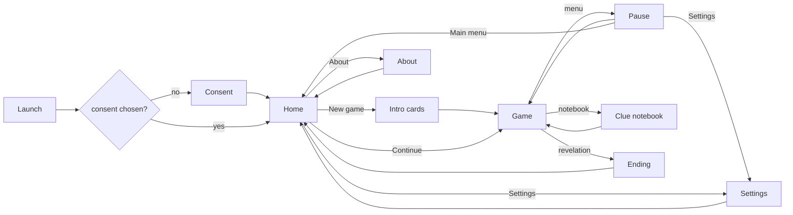

# PRD: Mini Mansion

Status: approved
Project slug: mini-mansion
Final app name: Mini Mansion
Android package: io.github.nhilaire.minimansion
Version target: 0.1.0
Last updated: 2026-10-20

> Written in English. Player-facing text is quoted in the "Player copy" section, in every language of the game
> (`factory-app.json` "languages"; French is the reference).
> Status becomes `approved` only after the user explicitly approves this document.
>
> Sources: `docs/BRIEF.md` (discovery answers), which amends the user's local draft "Le Secret de la Maison" and its
> navigation plan. Every rule kept from the draft is restated here: this PRD is the only source of truth.

## Summary

Mini Mansion is a family pixel-art point-and-click adventure inspired by Maniac Mansion, set in a family house
(provisional art in v0.1, later drawn from the author's room photos). Sam, a teenager from the neighbourhood and a
friend of the three sons, has heard a rumour: the father has invented a secret recipe with extraordinary powers that
could cause a disaster in town. Sam sneaks into the house through the key under the doormat, studies the habits of
the five inhabitants, lures them out of their rooms with clever distractions (a ball, drums, a chess piece, the
doorbell, the washing machine), combines objects, cracks a chess problem, a computer and a safe, and finally finds
the father's secret lab behind a painted-over door in the attic. The truth: a gluten-free, lactose-free chocolate
cake for a baking contest. The fun is in observing, sneaking and the "aha" of each puzzle, with family humour; being
caught only sends Sam to the wine cellar, never loses progress, and there is no hint system.

Pitch in French: « Une rumeur court : Papa aurait inventé une recette capable de provoquer une catastrophe. Glisse-toi
dans la maison, déjoue la famille et perce son secret ! »

## Target players

- Families, from about 10 years old; light humour and light mystery, never scary, no violence.
- Played on the couch or in transport, both hands, landscape.
- Total game length 3 h or more without help, over sessions of 10-30 min thanks to the autosave.
- Accessibility: finger-sized hotspots (>= 44 dp), readable pixel font scaled for phones, text stays on screen until
  tapped or its reading delay has elapsed; no reflex or timing challenge anywhere (stealth is event-driven).

## Core loop

1. Explore a place: tap the floor to walk, tap hotspots to see the possible actions, listen at closed doors.
2. Gather clues: look at things, talk to characters, read the clue notebook.
3. Take items, combine them, use them on hotspots or characters.
4. Lure an inhabitant away (event-driven distraction) to open a guarded room safely.
5. A puzzle is solved: a new item, place, clue or character move opens; "what does this unlock?" pulls the player on.

## Use cases

| ID | As a player I want to... | So that... |
|---|---|---|
| UC-01 | choose whether to share anonymous statistics at first launch, in my phone's language | my privacy is respected |
| UC-02 | start a new game with a short intro and a guided first scene | I understand the story and the controls |
| UC-03 | walk Sam around places and between places | I can explore the house and its garden |
| UC-04 | look at, take, use and combine objects, and talk to characters | I can investigate and solve puzzles |
| UC-05 | learn where each inhabitant is and lure them away | I can sneak into guarded rooms |
| UC-06 | be caught without losing anything and escape from the wine cellar | a mistake is funny, not punishing |
| UC-07 | read my clue notebook | I remember codes and facts I learnt |
| UC-08 | quit at any moment and continue later where I was | a long adventure fits short sessions |
| UC-09 | reach the revelation and see my play time | I get closure and a sense of achievement |
| UC-10 | turn sound, music and statistics on or off, change the language, or erase my game | I control the experience |
| UC-11 | read why this game exists | I know the story behind it |

## Screens

- **Consent** (first launch only): factory consent screen in the current language, accept and refuse equally
  visible.
- **Home:** title "Mini Mansion" in pixel style with the subtitle `home.subtitle` over a pixel view of the house at
  dusk; buttons `home.continue` (only when an unfinished save exists), `home.newGame`, `home.settings`,
  `home.about`. `home.newGame` with an unfinished save asks `home.confirmNew` first.
- **Intro:** 3 text cards (`intro.card1-3`) over pixel illustrations, tap to advance, `intro.skip` button. The game
  then starts in `front` (in front of the house) with the first tutorial bubble.
- **Game:** the place scene (fills the screen height, landscape), Sam and the characters present, a text banner for
  spoken lines, the inventory bar along the bottom (one row, scrollable), a notebook button and a menu button (top
  right). Overlays: action menu, dialogue choices, digit keypad (computer, safe), chess board.
- **Clue notebook:** the list of entries learnt so far (see "Clue notebook"), newest first, `notebook.empty` when
  none; `notebook.close`. The notebook button shows a dot while an entry is unread.
- **Pause:** `pause.resume`, `pause.settings`, `pause.home` (progress is already saved).
- **Ending:** final cutscene cards, then `ending.title`, play time (`ending.time`), number of captures
  (`ending.captures`), `ending.home`. After the ending the save is marked finished: Home shows no `home.continue`.
- **Settings:** toggles `settings.sfx`, `settings.music`, `settings.telemetry`; language (`settings.languageAuto`
  + one entry per language, each named in itself); button `settings.erase` (with `settings.confirmErase`);
  `settings.back`.
- **About:** `about.storyTitle` + `about.story`, `about.authorTitle` + the word from the author (passionate
  independent developer, adapted to tu), `about.dataTitle` + data text, version.

## Rules and scoring

There is no score and no failure. Progress = flags, character states, notebook and inventory of the pure TypeScript
engine. The "Ending" shows play time and captures.

### World and rendering

- Logical resolution 320x180 px per scene, scaled with nearest-neighbour to the screen height (letterboxed if
  needed). Scenes do not scroll.
- All art is pixel art drawn in code (pixel arrays and palettes in the repository), provisional in v0.1: each scene
  shows the furniture and every interactive object listed below at a plausible place. No external image.
- Each place has a walkable area (polygons). A tap on the floor makes Sam walk along the shortest path inside the
  walkable area to the tapped point, or to the nearest walkable point if the tap is outside. Speed 60 logical px/s.
- Sam: sprite 24x48 logical px, 4-frame walk cycle at 8 fps, 3 drawn directions (side mirrored for left/right, up,
  down), idle frame per direction. The 5 inhabitants have a 2-frame idle animation and a talk frame, plus an
  activity pose where they have one (drumming, playing chess, folding laundry, cooking, gardening, playing
  football, typing).
- Touch targets: the scene is scaled so that 1 logical px >= 2 dp on a 360 dp-high landscape screen; every hotspot
  and exit tap area is at least 22x22 logical px (>= 44 dp).

### Characters

| Id | Name | Role | Start state |
|---|---|---|---|
| hero | Sam | the player, teenager from the neighbourhood | outside, in `front` |
| dad | Papa | invents the cake in secret; types at the computer | `office` |
| mom | Maman | folds laundry | `parents` |
| julien | Julien | football fan, medals and trophies | `julien` (his room) |
| florent | Florent | drums, Nerf guns, video games, his bike in the garage | `florent` (his room) |
| theo | Théo | chess and Rubik's Cubes | `theo` (his room) |

The first names are fictional. Character states change only through the events of the "Character states" table;
no random movement, no timer.

### Places and exits (canonical plan)

24 places. An exit is a door or edge hotspot: tapping it walks Sam there and changes place. An exit not listed here
does not exist. In the user's plan, "Entrée" seen from outside means the front of the house (`front`).

| Id | Place | Exits (direction -> destination) |
|---|---|---|
| front | Devant la porte (front door, doormat, doorbell) | front door -> hall (locked until E01); left -> football; right -> pool |
| football | Coin foot | right -> front; middle -> pool; left -> garden |
| pool | Piscine (pool, cover, cover switch, pump) | left -> front; middle -> football; bay window -> living (locked from inside until opened from living) |
| garden | Jardin (flowers, swing) | right -> football |
| hall | Entrée (grand staircase) | front door -> front; left -> living; right -> corridor0; stairs -> landing |
| living | Salon (chessboard, sofa, bookshelf) | right -> hall; left -> music; bay window -> pool |
| music | Coin musique (piano, guitar, xylophone, drums) | right -> living; left -> dining |
| dining | Salle à manger (table, bread basket) | right -> music; left -> kitchen |
| kitchen | Cuisine (dead end) | right -> dining |
| corridor0 | Couloir du rez-de-chaussée | back -> hall; door 1 -> wc0; door 2 -> office; door 3 -> utility; stairs down -> garage |
| wc0 | WC du rez-de-chaussée | door -> corridor0 |
| office | Bureau de Papa (computer) | door -> corridor0 |
| utility | Cellier (washing machine, shelves) | door -> corridor0 |
| garage | Garage (tools, Florent's bike, crate, ladder, trapdoor) | stairs up -> corridor0; ladder -> attic; trapdoor -> cellar |
| cellar | Cave à vin (wine racks, shutter) | trapdoor -> garage (locked during a capture, see Captures); shutter -> front (once opened) |
| attic | Grenier (boxes, paint stain) | ladder -> garage; secret door -> laundry (after E12) |
| laundry | Buanderie secrète (Papa's lab) | door -> attic |
| landing | Couloir de l'étage (doors in this order from the stairs) | stairs -> hall; door 1 -> wc1; door 2 -> julien; door 3 -> bathroom; door 4 -> theo; door 5 -> florent; door 6 -> parents |
| wc1 | WC de l'étage | door -> landing |
| julien | Chambre de Julien (trophies, medals) | door -> landing |
| bathroom | Salle de bains du couloir | door -> landing |
| theo | Chambre de Théo (Rubik's Cubes, chess posters) | door -> landing |
| florent | Chambre de Florent (Nerf, video games, Nerf modding kit) | door -> landing |
| parents | Chambre des parents (bed, painting hiding the safe, sinks, mirror, shower) | door -> landing |

- The secret laundry adjoins the parents' bedroom but has no door to it: the attic is its only access.
- The bay window: from `pool`, using it says `line.bayLocked`; using it from `living` opens it for good (flag
  `bay_open`), after which it works both ways.
- Rooms without a puzzle (wc0, wc1, bathroom, kitchen, garden) still have at least 3 hotspots with a look line.
  Every place has at least 2 look-only hotspots besides those of the puzzles.

### Interaction

- Tapping a hotspot opens the action menu next to it with only the verbs that apply: `verb.look` (always),
  `verb.take` (takeable items), `verb.talk` (characters, and closed doors of occupied rooms: Sam listens and the
  occupant answers through the door), `verb.use` (operable objects). Tapping elsewhere closes it.
- Choosing a verb makes Sam walk to the hotspot's interaction point, face it, then the engine runs the action and
  shows the response line.
- Inventory: tapping an item selects it (highlight + banner `game.useWith`); the next tap on a hotspot, a character
  or another inventory item makes Sam apply it (walk there first for scene targets; "give" when the target is a
  character; "combine" when it is an item). Tapping the selected item again clears the selection. Long press on an
  item = look at it.
- Wrong combinations answer one of 6 generic lines in rotation (`line.wrong1-6`), never consume anything and change
  no state.
- Spoken lines: shown in the banner in the speaker's colour; dismissed by a tap or after max(2 s, 50 ms x length).
  Input on the scene is ignored while a line or a cutscene is playing.
- An item is removed from the inventory only when it is used up by its puzzle and is no longer needed.

### Dialogues

- Talking to a character opens 2-4 lines to choose from; each choice plays a short exchange; `dialogue.bye` always
  ends it. Options depend on flags (new topics appear with progress); exhausted topics are greyed but stay readable.
  No choice can block progress.
- Busy characters answer one line and no menu: Florent drumming (`line.florentBusy`), Théo playing chess
  (`line.theoBusy`).
- Talking through a closed door of an occupied room gives the occupant's door line (see Clues); no menu.

### Character states (event-driven)

| Character | State | Place | Leaves it when | Next state |
|---|---|---|---|---|
| dad | at_desk | office | E16: Sam rings the doorbell (after E01) | cooking (kitchen) for the rest of the game, until the ending |
| mom | folding | parents | E17: the washing machine's cycle ends (at the first place change after starting it) | gardening (garden) for the rest of the game |
| julien | in_room | julien | E02: the ball rolls to the football corner | football (football) for the rest of the game |
| florent | in_room | florent | E03: the drumsticks are used on the drums | drumming (music) |
| florent | drumming | music | the O-ring has been taken and Sam leaves `florent` | in_room (florent) again |
| theo | in_room | theo | E04: the white queen is put back on the chessboard | chess (living) |
| theo | chess | living | the Rubik's Cube is solved and Sam leaves `theo` | in_room (theo) again, CUT07 plays |

Each move plays a short cutscene with a line (see Cutscenes). An inhabitant met in a common place (any place not
guarded) greets Sam or talks; it never captures.

### Guarded rooms and captures

- A guarded room is a room whose occupant is in it: `office` (dad at_desk), `parents` (mom folding), `julien`
  (julien in_room), `florent` (florent in_room), `theo` (theo in_room).
- Announcement: whenever Sam is in the place leading to a guarded room (corridor0 or landing), the occupant's
  activity sound plays and looking at its door gives a line saying who is inside; talking at the door gives the
  occupant's door line. Entering is never blocked.
- Entering a guarded room = capture: the occupant catches Sam (capture line of that occupant), the screen fades and
  Sam is put in `cellar` with the trapdoor locked (`line.trapLocked` when used). Inventory, flags, character states,
  notebook and solved puzzles never change because of a capture. `captures` is incremented.
- Shutter (E15): it is stuck (`line.shutterStuck`) until the Barre de fer (in a wine rack, takeable at any time) is
  used on it; it then stays open for good (flag `shutter_open`, the bar is removed, `puzzle_solved {15}`) and the
  shutter exit leads to `front`. After any escape through the shutter, the trapdoor is unlocked again.
- Sam can also visit the cellar freely through the garage trapdoor and open the shutter then (this solves E15).
- A capture while the shutter is closed: Sam must open it (E15). A capture while it is already open (a later capture,
  or a first capture after a free opening): a short scene with `line.captureAgain`, Sam is put in `cellar` and walks
  out through the shutter.
- A capture can only happen when entering a guarded room, never while walking in a common place.

### Puzzle chain

Puzzle ids keep the draft's numbering (E01-E15) and add the two lures (E16-E17). All puzzles except E15 are needed
to finish (the keypads only accept a code once it is in the notebook, so no code can be guessed).

Dependencies (checked by AC-31): E02, E03, E16, E17 in any order after E01; E04 after E02; E05 after E04; E06 after
CUT07 (E05); E07 after E06 and E16; E08 after E03 and E17; E09 after E08; E10 after E09 (and E17); E14 after E02;
E11 after E14; E12 after E10 and E11; E13 after E12 and E07. E15 is optional (after a capture, or a free visit).

Items: Clé de la maison, Perche, Rallonge, Perche rallongée, Baguettes, Dame blanche, Livret du Rubik's Cube,
Joint torique, Clé à molette, Pince, Lessive, Dissolvant, Clé ancienne, Photo du gâteau, Fragment de recette, Mot de
Papa, Barre de fer (names in the Player copy).

| # | Puzzle | Condition | Effect |
|---|---|---|---|
| E01 | Look at / take the doormat in `front`: the house key is under it; use the key on the front door | - | + Clé de la maison, then - Clé; door unlocked for good; CUT01 (Sam slips in) |
| E02 | Free Julien's ball stuck on the pool cover: take the Perche (garage wall) and the Rallonge (behind the crate, garage), combine them, use the Perche rallongée on the ball | the Perche alone on the ball: `line.poleShort`, nothing changes | - Perche, - Rallonge, + Perche rallongée (combine); then - Perche rallongée; CUT04: the ball rolls to the football corner, Julien runs out (julien -> football) |
| E03 | Take the Baguettes from the bread basket (dining), use them on the drums (music) | - | - Baguettes; CUT05: Florent comes down and drums (florent -> drumming) |
| E04 | Take the Dame blanche from Julien's trophy (julien, Julien away), put it on the chessboard (living) | the chessboard's look line says the white queen is missing | - Dame blanche; CUT06: Théo comes down and plays against himself (theo -> chess) |
| E05 | Take the Livret du Rubik's Cube (living bookshelf), use it on the Rubik's Cube on Théo's desk (theo, Théo away) | - | - Livret; cube solved (flag); when Sam then leaves `theo`: theo -> in_room and CUT07 (monologue) |
| E06 | After CUT07, use the chessboard (living): Théo's chess problem, mate in 2 (see Chess problem) | before CUT07: `line.chessBusy` (Théo is playing) or the look line (queen missing) | notebook N08 (computer code 7867) |
| E16 | Ring the doorbell (front) | before E01: `line.bellRefuse`; dad already cooking: `line.bellNobody` | CUT02: Papa opens, sees nobody (Sam hides behind the hedge), goes to cook (dad -> cooking) |
| E07 | Use the computer (office, Papa away), type 7867 on the keypad | N08 not yet in the notebook: `line.codeUnknown`, the keypad does not open; wrong code: `line.codeWrong`, unlimited tries | CUT: documents shown (`doc.computer1-3`); notebook N09, N10 |
| E17 | Take the Lessive (utility shelf), use it on the washing machine (utility) | machine used without Lessive: `line.machineEmpty`; after E17: `line.machineDone` | - Lessive; the machine runs; at the next place change: `line.machineDing`, mom -> gardening |
| E08 | Repair the shower (parents, Maman away): use the Joint torique (florent: the Nerf modding kit, Florent away) and the Clé à molette (garage workbench) on the shower, in any order | shower used before both: `line.showerBroken` | - Joint, - Clé à molette (each when used); shower repaired (flag) |
| E09 | Use the shower: hot water runs, the steam reveals a code on the mirror (CUT08) | shower not repaired: `line.showerBroken` | notebook N11 (safe code 1987) at the end of CUT08; the digits stay on the mirror for good (mirror look repeats the code; using the shower again replays only the water) |
| E10 | Look at the painting (parents): it hides the safe; use the safe, type 1987 | N11 not yet in the notebook: `line.codeUnknown`, the keypad does not open; wrong code: `line.codeWrong`, unlimited tries | + Clé ancienne, + Photo du gâteau, + Fragment de recette, + Mot de Papa; notebook N12 |
| E14 | Drain the pool: open the cover with the cover switch (pool), take the Pince (garage), use it on the pump, use the pump, then take the Dissolvant from the drained pool floor | cover switch before E02: `line.coverBall`; pump before the Pince: `line.pumpPlug`; pump with cover closed: `line.pumpCover` | - Pince; CUT: the pool empties and a take hotspot "flacon" appears on the floor; + Dissolvant when taken (E14 is solved when taken) |
| E11 | Use the Dissolvant on the paint stain (attic) | - | - Dissolvant; CUT09: the outline of a door appears (locked) |
| E12 | Use the Clé ancienne on the revealed door (attic) | before E11: the stain's look line; door used without the key: `line.doorLocked` | - Clé ancienne; CUT10: the door opens; exit attic -> laundry |
| E13 | In the laundry, use the Fragment de recette on Papa's recipe notebook | computer documents not read (E07 not done): `line.finalMissing` | - Fragment; CUT11 (revelation), then Ending |
| E15 | Open the cellar shutter with the Barre de fer (see Captures), after a capture or during a free visit | shutter used without the bar: `line.shutterStuck` | - Barre de fer; shutter open for good |

- Effects happen exactly once; a solved puzzle stays solved; trying again gives the "already done" look line.
- The Photo du gâteau and the Mot de Papa are look-only items (narrative clues): they have no use target and stay in
  the inventory until the end.
- Taking the Dame blanche, the Livret, the Joint, the Lessive or the Barre de fer is possible as soon as Sam can
  stand next to them; items found before their puzzle stay in the inventory.
- Always winnable: from every reachable state, the ending is reachable (exhaustive search of the engine's state
  graph in a unit test), and no item needed later can be removed early.

### Chess problem (E06)

- Position (white to move, mate in 2): White Kg1, Qc4, Nh6, pawns f2, g2, h2. Black Kh8, Rd8, pawns g7, h7.
- Reference solution: 1. Qg8+ Rxg8 (forced, played automatically) 2. Nf7# (smothered mate).
- Board overlay: 8x8 with coordinates. The player taps a white piece (its legal destinations are highlighted), then
  a destination; only legal moves are accepted. Black answers automatically with its only/first legal reply.
- A first move other than Qg8+ shows `chess.wrong` and resets the position; after Qg8+ Rxg8, a second move other than
  Nf7 shows `chess.wrong` and resets. Unlimited tries; `chess.reset` and `chess.close` buttons.
- On mate: `chess.solved` with Théo's note: "a=1 ... h=8: the squares of the solution give the code" -> g8 f7 ->
  7 8 6 7 -> code 7867, written in the notebook (N08).
- A unit test with a legal-move generator proves that Qg8+ is the only first move that mates in 2 and that Nf7 is the
  only mating reply; if it fails, the position is replaced and this PRD updated.

### Cutscenes

Each cutscene has an id, a trigger, lines and a final state, and plays once (flag `cut_<id>`). Saving during a
cutscene stores the state after it (the cutscene is completed before saving).

| Id | Trigger | Content |
|---|---|---|
| CUT01 | E01 door unlocked | Sam slips into the hall; free control |
| CUT02 | E16 | the bell rings, Papa opens: `line.dadDoor1`, `line.dadDoor2`; he goes to the kitchen |
| CUT04 | E02 | the ball rolls away; Julien: `line.julienBall`; he runs to the football corner |
| CUT05 | E03 | drum noise; Florent: `line.florentDrums`; he drums in the music corner |
| CUT06 | E04 | Théo: `line.theoQueen`; he sits at the chessboard |
| CUT07 | cube solved and Sam leaves `theo` | Théo comes back up (`line.theoBack`), then behind his door: `line.theoMono1-3` (the cube, the safe in the parents' room and a secret passage he never found, his father who stares at the shower mirror without shaving); notebook N07 |
| CUT08 | E09 shower used | steam fills the bathroom area, digits 1987 appear on the mirror; notebook N11 |
| CUT09 | E11 | the stain dissolves, a door outline appears |
| CUT10 | E12 | the secret door opens |
| CUT11 | E13 | Papa climbs into his lab (`line.final1-6`): the "disaster" is a gluten-free, lactose-free chocolate cake for the town baking contest; the family gathers and tastes it |

### Clue notebook

Entries are added once, when their trigger happens, and never reveal a solution not yet found.

| Id | Trigger | Content (`notebook.nXX`) |
|---|---|---|
| N01 | new game | the rumour: Papa's dangerous secret recipe |
| N02 | Julien's door line or look at the ball on the pool cover | Julien would run outside at once if his ball were not stuck on the pool cover |
| N03 | Florent's door line | Florent would play the drums if he found his drumsticks |
| N04 | Théo's door line or chessboard look | the chessboard misses its white queen; Théo won't play without it and thinks Julien took it for one of his trophies |
| N05 | Maman's door line | Maman will only go down once someone runs the washing machine |
| N06 | Papa's door line | Papa only leaves his desk to open the front door when someone rings |
| N07 | CUT07 | Théo suspects a safe in the parents' room and a secret passage; Papa stares at the shower mirror |
| N08 | E06 | computer code 7867 |
| N09 | E07 | "Opération Moelleux" and the town baking contest |
| N10 | E07 | the attic: a repainted door, "don't forget the thinner"; the thinner fell into the pool |
| N11 | CUT08 | safe code 1987 |
| N12 | E10 | Papa's note: the rest of the recipe is in the lab |

### Clues (no hint system)

Every step has at least one in-world clue (look line, door line or dialogue), listed in the content files and
checked by a unit test that maps each puzzle step to its clue keys:

- E01: doormat look (bulging in the middle). E02: Julien's door line (why: he would run out for his ball); ball
  look; Perche alone (`line.poleShort`); crate look (something behind it). E03: drums look (no sticks); Florent's
  door line; bread basket look (« des baguettes, mais pas de pain »; the English line is adapted so the joke and the
  clue still work, e.g. "drumsticks... but no chicken"). E04: chessboard look; Théo's door line (Julien took the
  queen for a trophy); trophy look (the footballer's head replaced by a white queen).
- E05: cube look (scrambled); booklet look. E06: chessboard look after CUT07 (Théo's problem and note).
- E16: Papa's door line (« Je n'ouvre à personne… sauf si on sonne »). E07: computer look (post-it: the code is in
  Théo's chess problem).
- E17: Maman's door line (she will go down once someone runs the washing machine); machine look (no detergent).
- E08: shower look (worn seal, loose fitting; Florent has plenty of seals for his Nerf guns); modding kit look;
  wrench look. E09: CUT07 (mirror); mirror look. E10: CUT07 (safe); painting look (crooked).
- E14: N10; pool look after opening the cover (a bottle at the bottom); pump look (unplugged, bent plug); Julien's
  dialogue (the bent plug needs pliers). E11: N10; stain look. E12: N12; locked door line. E13: N12; recipe notebook
  look. E15: shutter look (needs a lever); wine rack look.

### Tutorial (first scene)

On a new game, 3 bubbles guide the player in `front`, each shown once: (1) `tutorial.walk` until Sam has walked;
(2) `tutorial.verbs` until a verb was used; (3) when the first item enters the inventory: `tutorial.inventory` until
an item was selected. Then the tutorial is complete. No hint system afterwards.

### Persistence

- Autosave (local storage) after every completed action, place change, dialogue end and cutscene end, and when the
  app goes to the background: place, Sam's position, inventory, flags, character states, notebook (with unread
  marks), played cutscenes, captures, tutorial state, play time, finished flag, save version.
- Play time counts only while the Game screen is displayed and not paused or in background.
- `home.continue` restores the exact state. A corrupt or unknown-version save is ignored (Home shows no
  `home.continue`) and reported as a non-fatal error.
- Settings (sfx, music: on by default; language: automatic) and consent are stored separately and survive
  `settings.erase`.

### Ending

- When E13 resolves, the save is marked finished and `game_complete` is sent once, before CUT11. If the app is killed
  during CUT11 or the Ending screen, the relaunch shows Home without `home.continue`, and nothing is sent again.
- Play time: whole minutes rounded down, minutes always 2 digits, hours without padding ("0 h 05", "3 h 12" in
  French; "0 h 05" in English too).

## Look, sound and feel

- Retro pixel art in a limited palette (warm house colours, dusk blues outside), nearest-neighbour scaling, pixel
  font. Original art only, drawn in code; no Lucasfilm character, name or asset. Each inhabitant has a distinct
  colour and silhouette.
- v0.1 scenes are provisional. Later versions will redraw them from the author's room photos with a local
  conversion script; the photos are personal data and live in `photos/`, which is git-ignored from v0.1 on.
- Landscape orientation, immersive fullscreen.
- Sound effects (8-bit, synthesized by a script in the repository into bundled audio files): footsteps, door, item
  taken, wrong combination, puzzle solved jingle, doorbell, drums loop (music corner while Florent drums, also heard
  faintly in the living room and dining room), washing machine and its ding, running water, pump, safe beep, secret
  door, capture sting, and one activity sound per guarded room (typing, radio commentary, video game, cube clicks,
  humming).
- Music: one chiptune ambient loop for the house and one short ending theme, synthesized the same way, low volume,
  paused with the app. `settings.sfx` and `settings.music` toggles.
- No haptics.

## Telemetry events

Only events listed here may be sent (after consent). Params: numbers, booleans or short enums. No identifiers.
`duration_s` is the total play time of the current game in seconds.

| Event | When | Params | Feeds KPI |
|---|---|---|---|
| game_start | a game is started or continued | mode (`new`/`continue`) | Completion rate, Tutorial completion |
| tutorial_complete | the 3 tutorial steps are done | - | Tutorial completion |
| puzzle_solved | a puzzle E01-E17 is solved | puzzle (1-17), duration_s | Puzzle funnel, Median time to finish |
| capture | Sam is caught | room (`office`/`parents`/`julien`/`florent`/`theo`), count (captures so far, 1-n) | Captures per game |
| game_complete | the ending is reached (once per game) | duration_s, captures | Completion rate, Median time to finish, Captures per game |
| settings_change | a toggle or the language changes (telemetry: only when turned on, never after opt-out) | setting (`sfx`/`music`/`telemetry`/`language`), value (`on`/`off`/`auto`/`fr`/`en`) | Sound settings usage |

## KPIs

Business and technical indicators followed in Firebase (free Spark plan). Details and console paths in `docs/KPIS.md`.

| KPI | Type | Target | Source |
|---|---|---|---|
| Completion rate (users with game_complete / users with game_start mode=new) | business | >= 25% | Analytics events |
| Puzzle funnel (users per puzzle), biggest drop = where players get stuck | business | no single drop > 40% | puzzle_solved by puzzle |
| Median time to finish | business | 3 h - 5 h | game_complete duration_s |
| Captures per game (median, and by room) | business | median 1-4, no room > 50% of all captures | capture, game_complete captures |
| Tutorial completion | business | >= 90% of new games | tutorial_complete / game_start mode=new |
| Sound settings usage (share of players turning music or sfx off) | business | < 30% | settings_change |
| D1 / D7 retention | business | D1 >= 30%, D7 >= 15% | Analytics > Retention |
| Crash-free users | technical | >= 99% | Crashlytics |
| Cold start, APK size | technical | < 3 s, < 60 MB | evidence reports |

## Non-functional requirements

- Performance: smooth on a mid-range Android phone (walk animation without visible jank), cold start < 3 s.
- APK size (arm64): target < 60 MB, as the POC whose engine and rendering stack are reused (Skia alone weighs about
  11 MB; the POC's 49.7 MB was accepted by the user).
- Works fully offline. No account. No ads. No backend.
- Android: minSdk from the stack defaults; **landscape** orientation.
- Privacy: opt-in telemetry, no personal data, AD_ID permission removed. Room photos never enter the repository
  (`photos/` git-ignored).
- Testing hook: the deep link `minimansion://test/fast` makes walks instant and spoken lines short for the current run
  only, so that the end-to-end walkthrough fits the verification budget. It changes no rule and no save.

## Acceptance criteria

Each criterion is testable and tagged with its proof: `[unit]` Jest, `[e2e]` Maestro flow, `[device]` check on the
phone, `[manual]` human judgement (keep these rare).

Platform, language, privacy

- AC-01 [e2e] Given a first launch, when the app opens, then the consent screen is shown in the phone's language
  (fallback English if unsupported) with accept and refuse buttons.
- AC-02 [e2e] Given the consent screen, when the player accepts or refuses, then Home is shown, and on the next
  launch the consent screen is not shown again.
- AC-03 [unit] Given a phone in French / in English / in an unsupported language (e.g. Italian), then the UI and
  the game content are in French / English / English.
- AC-04 [e2e] Given Settings, when the player picks another language, then the whole UI and the game lines switch at
  once and the choice survives a restart; `settings.languageAuto` follows the phone again.
- AC-05 [device] Given the release APK installed, then the launcher shows "Mini Mansion" (in French and in English)
  and the app runs in landscape fullscreen.
- AC-06 [unit] Given telemetry refused (or turned off in settings), when any game event occurs, then nothing is sent;
  given consent, only the events and params of the "Telemetry events" table are sent; turning statistics off sends
  nothing, turning them on sends `settings_change {telemetry, on}` after consent is granted.
- AC-07 [unit] Given any telemetry event, when it is built, then its params are only numbers and the listed enums.
- AC-08 [device] Given consent accepted, when a scripted game runs on the emulator, then logcat shows `game_start`,
  `tutorial_complete` and `puzzle_solved` events.
- AC-09 [unit] Given the repository, then `.gitignore` ignores `photos/` and no file under `photos/` is tracked.

Home, intro, tutorial

- AC-10 [e2e] Given no save, then Home shows the title, the subtitle, new game, settings and about, and no continue;
  given an unfinished save, continue is shown too.
- AC-11 [e2e] Given Home, when new game is tapped, then the 3 intro cards can be advanced (or skipped) and the game
  starts in `front` with the first tutorial bubble.
- AC-12 [unit] Given the tutorial, then the 3 steps appear in order under the rules' conditions, each once, and
  completion is recorded after the 3rd.

Movement and interaction

- AC-13 [unit] Given a place's walkable area, when a point is tapped, then the computed path stays inside the area
  and ends at the point (or the nearest walkable point if outside); Sam moves at 60 px/s along it.
- AC-14 [unit] Given Sam walking, then direction and animation frame follow the rules (4 frames at 8 fps, left =
  mirrored right, idle frame when stopped).
- AC-15 [unit] Given the world data, then the 24 places and their exits are exactly those of the "Places and exits"
  table (each exit leads where the table says, the bay window and the shutter follow their lock rules, the laundry
  is reachable only from the attic).
- AC-16 [e2e] Given `front` after E01, when the player taps the floor, then Sam walks there; when the front door is
  tapped, then the hall is displayed.
- AC-17 [unit] Given a hotspot, then the action menu offers only its applicable verbs (look always; take, talk, use
  when applicable; talk on the door of an occupied room).
- AC-18 [unit] Given an item selected and a target (hotspot, character or item), then a valid combination runs its
  effect and a wrong one shows a generic line in rotation without changing inventory or flags.
- AC-19 [unit] Given every place's hotspots and exits, then each tap area is at least 22x22 logical px, every place
  has the minimum number of look hotspots, and the scale rule gives >= 2 dp per logical px on a 360 dp-high screen.
- AC-20 [unit] Given each character, then the dialogue choices shown depend on flags as specified, `dialogue.bye` is
  always present, busy characters answer their busy line, and no choice blocks progress.

Puzzles, characters, captures

- AC-21 [unit] For each puzzle E01-E17, given its condition unmet, then the action is refused with the rule's line
  (where one is defined) and the state does not change; given it met, then the effect of the table happens exactly
  once and `puzzle_solved` is emitted once with the right puzzle number.
- AC-22 [unit] Given the character states table, then each inhabitant changes state only on its listed event, the
  moves of Florent and Théo back to their rooms happen when Sam leaves their room under the listed conditions, and
  CUT07 plays exactly once.
- AC-23 [unit] Given each guarded room with its occupant present, when Sam enters it, then a capture happens (Sam in
  the cellar, trapdoor locked, `captures` + 1, `capture` event with the room) and inventory, flags, notebook and
  character states are unchanged; given the occupant away, then no capture happens; walking in a common place never
  captures.
- AC-24 [unit] Given a capture with the shutter closed, then the shutter is stuck until the Barre de fer is used on
  it (E15), the shutter then leads to `front` and the trapdoor is unlocked; given the shutter opened during a free
  visit, then E15 is solved; given a capture with the shutter already open, then `line.captureAgain` plays and Sam
  can walk out at once.
- AC-25 [unit] Given Sam in corridor0 or landing next to a guarded room, then the occupant's activity sound is
  requested and the door's look and talk lines name the occupant.
- AC-26 [unit] Given the chess problem, then only legal moves are accepted, Qg8+ is answered by Rxg8, Nf7 mates and
  writes code 7867 in the notebook, any other move shows `chess.wrong` and resets, and a legal-move generator proves
  Qg8+ is the only first move mating in 2 and Nf7 the only mating reply.
- AC-27 [unit] Given the computer and the safe keypads, then they do not open (`line.codeUnknown`) until N08
  (computer) / N11 (safe) is in the notebook; once open, only 7867 (computer) and 1987 (safe) are accepted, any
  other 4-digit code shows `line.codeWrong` with unlimited tries; the computer cannot be reached while Papa is at
  his desk (entering the office then is a capture).
- AC-28 [unit] Given the pool, then the cover switch refuses before E02, the pump refuses without the Pince or with
  the cover closed, and after draining a take hotspot gives the Dissolvant (E14 solved when taken).
- AC-29 [unit] Given the notebook, then each entry N01-N12 is added once on its trigger (N11 at the end of CUT08),
  is marked unread until the notebook is opened, and no entry appears before its trigger.
- AC-30 [unit] Given every puzzle step, then at least one in-world clue key from the "Clues" list exists in every
  language and is reachable before or at that step.
- AC-31 [unit] Given the engine's state graph explored exhaustively from a new game over all actions (captures
  included), then from every reachable state the ending remains reachable (no dead end), no needed item can be
  removed early, and no puzzle can be solved before the puzzles it depends on (the "Dependencies" list).
- AC-32 [unit] Given the engine, when the full solution sequence is played, then E13 leads to the ending, the save is
  marked finished and `game_complete` is emitted exactly once with duration and captures.
- AC-33 [e2e] Given the Salon after E01, when the bookshelf is tapped and take chosen, then the Livret du Rubik's Cube
  appears in the inventory.
- AC-34 [e2e] Given a game in progress, when the notebook button is tapped, then the notebook lists the learnt
  entries (N01 at least) and closes back to the game.

Persistence, pause, ending, settings, about

- AC-35 [unit] Given a game state, when it is saved and loaded, then the restored state is identical (place,
  position, inventory, flags, character states, notebook, cutscenes, captures, play time); given a corrupt or
  unknown-version save, then it is ignored and a non-fatal error is reported.
- AC-36 [e2e] Given a game in progress with an item taken, when the app is killed and relaunched and continue
  tapped, then Sam is in the same place with the same inventory.
- AC-37 [e2e] Given an unfinished save, when new game is tapped, then a confirmation is asked; confirming starts a
  fresh game.
- AC-38 [unit] Given the play time counter, then it advances only while the Game screen is active and not paused or
  in background.
- AC-39 [e2e] Given a game in progress, when the menu button is tapped, then Pause shows resume, settings and main
  menu; when the app goes to the background and comes back, then the game is paused.
- AC-40 [unit] Given play times of 0 s, 59 s, 300 s, 3599 s and 11520 s, then the Ending shows "0 h 00", "0 h 00",
  "0 h 05", "0 h 59" and "3 h 12", and the number of captures.
- AC-41 [e2e] Given the full walkthrough flow on the release build (fast mode), when it is played from a new game,
  then the Ending screen shows its title, a play time and the captures, and Home then shows no continue.
- AC-42 [e2e] Given Settings, then the sfx, music and statistics toggles, the language choice and erase are shown;
  changed toggles survive a relaunch; erasing (after confirmation) removes continue but keeps settings, language and
  consent.
- AC-43 [unit] Given sfx off, then no sound effect is played; given music off, then no music is played; music pauses
  when the app is in background.
- AC-44 [e2e] Given Home, when about is tapped, then it shows the story of this PRD (`about.story`), the word from the
  author and the version, in the current language.
- AC-45 [unit] Given the dictionaries, then every player-facing string (UI and game content) comes from `src/i18n/`
  or the per-language content files, fr and en have the same keys, French uses tu, the UI strings match the "Player
  copy" table, and French typography uses a no-break space before `: ; ! ?` and inside « ».

- AC-49 [unit] Given a spoken line, then it stays until tapped or until max(2 s, 50 ms x length) has elapsed, and
  scene input is ignored while a line or a cutscene plays.
- AC-50 [unit] Given a save requested during a cutscene, then the stored state is the state after the cutscene;
  given the app going to the background, then the game is saved; given the app killed during CUT11 or the Ending
  screen, then the relaunch shows no continue and `game_complete` is not sent again.

Technical and feel

- AC-46 [device] Given the release build on the emulator, when the cold start is measured, then it is < 3 s.
- AC-47 [device] Given the Maestro flows run on the release build, then logcat shows no crash and no ANR.
- AC-48 [manual] Given the APK on the user's phone, when the user plays the first hour, then walking, the action
  menu, the inventory and the notebook feel natural with a finger, the capture rules feel fair (always announced),
  the pixel art is readable and the humour works.

## Player copy

Key player-facing strings (French tone: tu). Dialogue, look lines, door lines, documents and notebook entries live in
the per-language content files (French reference, English translation); their keys are listed in the rules above.
French typography (no-break space before `: ; ! ?`, inside « ») is applied in code.

Final app name: fr "Mini Mansion", en "Mini Mansion". Language-specific assets: none (no image with text, no spoken
audio; all text is drawn by the UI).

| Key | fr | en |
|---|---|---|
| home.subtitle | Le Secret de la Maison | The House Secret |
| home.continue | Continuer | Continue |
| home.newGame | Nouvelle partie | New game |
| home.settings | Paramètres | Settings |
| home.about | À propos | About |
| home.confirmNew | Effacer ta partie en cours ? | Erase your current game? |
| common.yes / common.no | Oui / Non | Yes / No |
| intro.skip | Passer | Skip |
| intro.card1 | Une rumeur court dans le quartier : Papa aurait inventé une recette secrète aux pouvoirs extraordinaires… | A rumour is going around the neighbourhood: Papa has invented a secret recipe with extraordinary powers… |
| intro.card2 | Certains disent qu'elle pourrait provoquer une catastrophe dans toute la ville ! | Some say it could cause a disaster in the whole town! |
| intro.card3 | Sam, copain des garçons de la maison, décide d'enquêter. Discrètement. | Sam, a friend of the boys of the house, decides to investigate. Quietly. |
| tutorial.walk | Touche le sol pour faire marcher Sam. | Tap the ground to make Sam walk. |
| tutorial.verbs | Touche un objet ou une personne pour voir ce que tu peux faire. | Tap an object or a person to see what you can do. |
| tutorial.inventory | Tes objets sont ici. Touche-en un, puis touche ce sur quoi l'utiliser. | Your items are here. Tap one, then tap what to use it on. |
| verb.look / verb.take / verb.talk / verb.use | Regarder / Prendre / Parler / Utiliser | Look / Take / Talk / Use |
| game.useWith | Utiliser {objet} avec… | Use {item} with… |
| dialogue.bye | Au revoir | Goodbye |
| notebook.title | Carnet d'indices | Clue notebook |
| notebook.empty | Rien noté pour l'instant. | Nothing noted yet. |
| notebook.close | Fermer | Close |
| keypad.ok / keypad.clear / keypad.close | Valider / Effacer / Fermer | OK / Clear / Close |
| chess.title | Problème de Théo : les Blancs jouent et font mat en 2 coups | Théo's problem: White to play and mate in 2 |
| chess.wrong | Raté, les Noirs s'en sortent. On recommence ! | Missed, Black escapes. Try again! |
| chess.solved | Échec et mat ! | Checkmate! |
| chess.reset / chess.close | Recommencer / Fermer | Restart / Close |
| line.captureAgain | Encore toi ?! Allez, à la cave ! | You again?! Off to the cellar! |
| line.codeUnknown | Je ne connais pas le code. Inutile de taper au hasard. | I don't know the code. No point typing at random. |
| pause.resume / pause.settings / pause.home | Reprendre / Paramètres / Menu principal | Resume / Settings / Main menu |
| ending.title | Fin | The End |
| ending.time | Temps de jeu : {h} h {mm} | Play time: {h} h {mm} |
| ending.captures | Captures : {n} | Times caught: {n} |
| ending.home | Menu principal | Main menu |
| settings.sfx / settings.music | Bruitages / Musique | Sound effects / Music |
| settings.telemetry | Partager des statistiques anonymes | Share anonymous statistics |
| settings.language / settings.languageAuto | Langue / Automatique (langue du téléphone) | Language / Automatic (phone language) |
| settings.erase | Effacer la partie | Erase the game |
| settings.confirmErase | Effacer ta partie ? Tu recommenceras depuis le début. | Erase your game? You will start again from the beginning. |
| about.storyTitle | L'histoire de ce jeu | The story of this game |
| about.story | Enfant, je passais des heures à fouiller chaque pièce du manoir de Maniac Mansion, chez une famille complètement folle. Cette fois, j'ai voulu que le manoir soit une vraie maison : la mienne, transformée en pixel art, avec ses habitants loufoques et un secret bien gardé. | As a child, I spent hours searching every room of the Maniac Mansion manor, home to a completely crazy family. This time, I wanted the mansion to be a real house: mine, turned into pixel art, with its zany inhabitants and a well-kept secret. |
| about.authorTitle | Un mot de l'auteur | A word from the author |
| about.dataTitle | Tes données | Your data |
| item names | Clé de la maison, Perche, Rallonge, Perche rallongée, Baguettes, Dame blanche, Livret du Rubik's Cube, Joint torique, Clé à molette, Pince, Lessive, Dissolvant, Clé ancienne, Photo du gâteau, Fragment de recette, Mot de Papa, Barre de fer | House key, Pole, Extension, Extended pole, Drumsticks, White queen, Rubik's Cube booklet, O-ring, Adjustable wrench, Pliers, Detergent, Paint thinner, Old key, Cake photo, Recipe scrap, Papa's note, Iron bar |

## Out of scope

- Several playable characters (Sam only), voice acting, multiple endings.
- Hint system, hotspot reveal, walkthrough in the app (deliberate choice; the draft's 3 hint levels are dropped).
- Timed stealth, hiding mechanic, random character movement (stealth is event-driven; hiding is scripted in CUT02).
- Photo-based room art and the photo conversion script (a later version; v0.1 uses provisional code-drawn scenes).
- Languages other than French and English.
- Manual save slots, cloud save, accounts, leaderboards, achievements, ads, in-app purchases, iOS, haptics.
- Any external or third-party art or music; any Lucasfilm character, name or asset.

## Open questions

None
